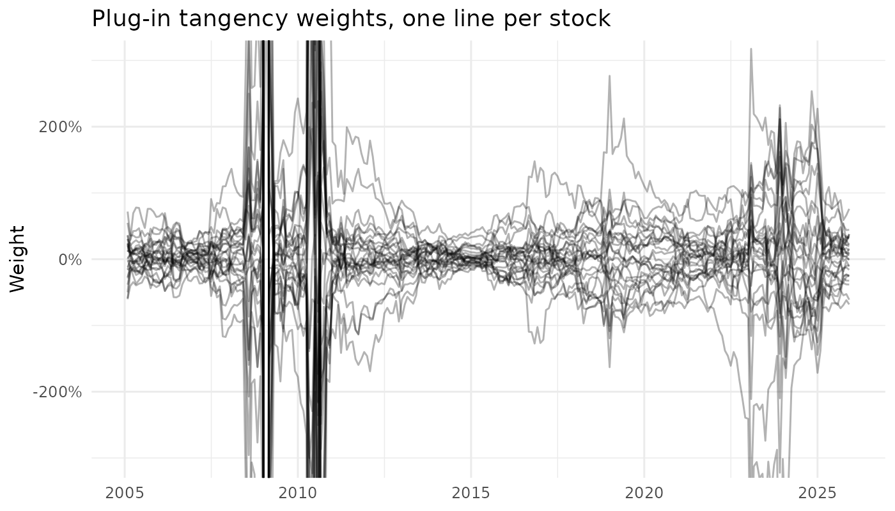

This exercise goes with [lecture 3](../slides/aef-03-estimation-uncertainty.pdf). You backtest four portfolio strategies with rolling windows on the monthly excess returns of today's Dow Jones stocks from [exercise 2](mean_variance.qmd#simulation-estimated-portfolios-true-parameters), January 2000 to December 2025. Excess returns are the returns minus the one-month T-bill rate, `risk_free` in `factors_ff3_monthly.parquet`. The first three code chunks repeat the code of exercise 2 that you need, so this page works on its own.

## Backtesting the Dow Jones {#backtesting-the-dow-jones}

**Exercises:**

1. Backtest four strategies with rolling windows on the monthly excess returns of the Dow Jones stocks. In every month $t$ from the 61st month on, estimate $\hat\mu$ and $\hat\Sigma$ from the 60 months before $t$, compute the weights of each strategy, and record its excess return in month $t$. The strategies are the plug-in tangency portfolio ($\hat\omega \propto \hat\Sigma^{-1}\hat\mu$), the plug-in minimum-variance portfolio ($\hat\omega \propto \hat\Sigma^{-1}\iota$), the $1/N$ portfolio, and the minimum-variance portfolio without short sales. The last one has no closed form: solve it as a quadratic program, with `solve.QP()` from the `quadprog` package (R) or `minimize()` from `scipy` (Python).
2. Compute the annualized mean, volatility and Sharpe ratio of the excess returns of each strategy. Which strategy has the highest Sharpe ratio?
3. Plot the weights of the plug-in tangency portfolio over time, one line per stock. Why does this portfolio fail? Hint: look at the denominator $\iota'\hat\Sigma^{-1}\hat\mu$ of the weights.
4. Lecture 3 lists traps of backtests. Which information does the backtest of task 1 use that an investor in 2005 did not have?

**Solutions:**

The solution uses the following packages and constants: the sample period and the length of the estimation window.

::: {.panel-tabset group="language"}
## R

```{r}
#| label: r-setup-backtesting
library(tidyverse)
library(tidyfinance)
library(nanoparquet)
library(quadprog)

theme_set(theme_minimal())

start_date <- "2000-01-01"
end_date <- "2025-12-31"

months_per_year <- 12

window_length <- 60
```

## Python

```{python}
#| label: py-setup-backtesting
import numpy as np
import polars as pl
import tidyfinance as tf
from plotnine import (
    aes,
    coord_cartesian,
    geom_line,
    ggplot,
    labs,
    scale_x_date,
    scale_y_continuous,
    theme_minimal,
    theme_set,
)
from scipy.optimize import minimize

theme_set(theme_minimal())

start_date = "2000-01-01"
end_date = "2025-12-31"

months_per_year = 12

window_length = 60
```
:::

The data are those of exercise 2: today's Dow Jones stocks with a return in every month of the sample, 27 stocks and 311 months from February 2000 to December 2025. The excess returns go into a matrix with one row per month and one column per stock.

::: {.panel-tabset group="language"}
## R

```{r}
#| label: r-excess-returns-backtesting
symbols <- download_data(
  domain = "Index Constituents",
  index = "Dow Jones Industrial Average"
)

prices_daily <- download_data(
  domain = "Stock Prices",
  symbols = symbols$symbol,
  start_date = start_date,
  end_date = end_date
)

returns_monthly <- prices_daily |>
  arrange(symbol, date) |>
  mutate(date = floor_date(date, "month")) |>
  summarize(price = last(adjusted_close), .by = c(symbol, date)) |>
  mutate(ret = price / lag(price) - 1, .by = symbol) |>
  drop_na(ret) |>
  mutate(months = n(), .by = symbol) |>
  filter(months == max(months)) |>
  select(symbol, date, ret)

risk_free <- read_parquet("data/factors_ff3_monthly.parquet") |>
  select(date, risk_free)

excess_wide <- returns_monthly |>
  left_join(risk_free, join_by(date)) |>
  mutate(ret_excess = ret - risk_free) |>
  pivot_wider(id_cols = date, names_from = symbol, values_from = ret_excess) |>
  arrange(date)
excess_matrix <- excess_wide |>
  select(-date) |>
  as.matrix()
n_stocks <- ncol(excess_matrix)
```

## Python

```{python}
#| label: py-excess-returns-backtesting
symbols = tf.download_data(
    domain="Index Constituents",
    index="Dow Jones Industrial Average",
)

prices_daily = tf.download_data(
    domain="Stock Prices",
    symbols=symbols["symbol"].to_list(),
    start_date=start_date,
    end_date=end_date,
)

returns_monthly = (
    prices_daily.sort("symbol", "date")
    .with_columns(date=pl.col("date").dt.truncate("1mo"))
    .group_by("symbol", "date", maintain_order=True)
    .agg(price=pl.col("adjusted_close").last())
    .with_columns(ret=pl.col("price").pct_change().over("symbol"))
    .drop_nulls("ret")
    .with_columns(months=pl.len().over("symbol"))
    .filter(pl.col("months") == pl.col("months").max())
    .select("symbol", "date", "ret")
)

risk_free = pl.read_parquet("data/factors_ff3_monthly.parquet").select(
    "date", "risk_free"
)

excess_wide = (
    returns_monthly.join(risk_free, on="date", how="left")
    .with_columns(ret_excess=pl.col("ret") - pl.col("risk_free"))
    .pivot(on="symbol", index="date", values="ret_excess")
    .sort("date")
)
excess_matrix = excess_wide.drop("date").to_numpy()
n_months, n_stocks = excess_matrix.shape
```
:::

The plug-in tangency and minimum-variance weights are the functions of exercise 2. `solve(sigma, mu)` in R and `np.linalg.solve(sigma, mu)` in Python compute $\Sigma^{-1}\mu$ without inverting $\Sigma$.

::: {.panel-tabset group="language"}
## R

```{r}
#| label: r-plug-in-weights
tangency_weights <- function(mu, sigma) {
  weights <- solve(sigma, mu)
  weights / sum(weights)
}

min_variance_weights <- function(sigma) {
  weights <- solve(sigma, rep(1, ncol(sigma)))
  weights / sum(weights)
}
```

## Python

```{python}
#| label: py-plug-in-weights
def tangency_weights(mu, sigma):
    weights = np.linalg.solve(sigma, mu)
    return weights / weights.sum()


def min_variance_weights(sigma):
    weights = np.linalg.solve(sigma, np.ones(len(sigma)))
    return weights / weights.sum()
```
:::

The minimum-variance portfolio without short sales minimizes $\omega'\hat\Sigma\omega$ subject to $\iota'\omega = 1$ and $\omega_i \geq 0$. `solve.QP()` minimizes $\frac{1}{2}b'Db - d'b$ subject to $A'b \geq b_0$, where the first `meq` constraints hold with equality: here $D = \hat\Sigma$, $d = 0$, and the columns of $A$ are $\iota$ (the budget constraint) and the $N$ unit vectors (no short sales). `minimize()` takes the constraints directly.

::: {.panel-tabset group="language"}
## R

```{r}
#| label: r-min-variance-no-short
min_variance_no_short <- function(sigma) {
  solve.QP(
    Dmat = sigma,
    dvec = rep(0, n_stocks),
    Amat = cbind(1, diag(n_stocks)),
    bvec = c(1, rep(0, n_stocks)),
    meq = 1
  )$solution
}
```

## Python

```{python}
#| label: py-min-variance-no-short
def min_variance_no_short(sigma):
    return minimize(
        lambda w: w @ sigma @ w,
        x0=np.ones(n_stocks) / n_stocks,
        jac=lambda w: 2 * sigma @ w,
        bounds=[(0, 1)] * n_stocks,
        constraints={"type": "eq", "fun": lambda w: w.sum() - 1},
        method="SLSQP",
        options={"ftol": 1e-12},
    ).x
```
:::

The backtest loops over the months. The weights for month $t$ only use the 60 months before $t$, so the return of month $t$ is out of sample.

::: {.panel-tabset group="language"}
## R

```{r}
#| label: r-backtest
backtest <- map(seq(window_length + 1, nrow(excess_matrix)), \(t) {
  window <- excess_matrix[(t - window_length):(t - 1), ]
  mu_hat <- colMeans(window)
  sigma_hat <- cov(window)
  weights <- list(
    "Plug-in tangency" = tangency_weights(mu_hat, sigma_hat),
    "Plug-in minimum variance" = min_variance_weights(sigma_hat),
    "1/N" = rep(1 / n_stocks, n_stocks),
    "Minimum variance, no short sales" = min_variance_no_short(sigma_hat)
  )
  tibble(
    date = excess_wide$date[t],
    strategy = names(weights),
    weights = weights,
    ret_excess = map_dbl(weights, \(w) sum(w * excess_matrix[t, ]))
  )
}) |>
  bind_rows()

backtest |>
  summarize(
    mean = mean(ret_excess) * months_per_year,
    volatility = sd(ret_excess) * sqrt(months_per_year),
    sharpe = mean / volatility,
    .by = strategy
  ) |>
  arrange(desc(sharpe))
```

## Python

```{python}
#| label: py-backtest
records = []
for t in range(window_length, n_months):
    window = excess_matrix[t - window_length : t]
    mu_hat = window.mean(axis=0)
    sigma_hat = np.cov(window, rowvar=False)
    weights = {
        "Plug-in tangency": tangency_weights(mu_hat, sigma_hat),
        "Plug-in minimum variance": min_variance_weights(sigma_hat),
        "1/N": np.ones(n_stocks) / n_stocks,
        "Minimum variance, no short sales": min_variance_no_short(sigma_hat),
    }
    for strategy, w in weights.items():
        records.append(
            {
                "date": excess_wide["date"][t],
                "strategy": strategy,
                "weights": w.tolist(),
                "ret_excess": w @ excess_matrix[t],
            }
        )
backtest = pl.DataFrame(records)

(
    backtest.group_by("strategy", maintain_order=True)
    .agg(
        mean=pl.col("ret_excess").mean() * months_per_year,
        volatility=pl.col("ret_excess").std() * np.sqrt(months_per_year),
    )
    .with_columns(sharpe=pl.col("mean") / pl.col("volatility"))
    .sort("sharpe", descending=True)
)
```
:::

The backtest runs from February 2005 to December 2025. Annualized, the excess returns of the four strategies are, from the R code (the Python code prints the same numbers):

| Strategy | Mean | Volatility | Sharpe ratio |
|---|---:|---:|---:|
| $1/N$ | 14.3% | 14.9% | 0.96 |
| Minimum variance, no short sales | 10.7% | 12.4% | 0.86 |
| Plug-in minimum variance | 12.4% | 15.8% | 0.78 |
| Plug-in tangency | about −2,000% | about 9,000% | −0.22 |

$1/N$, with nothing estimated, has the highest Sharpe ratio, as in DeMiguel, Garlappi, and Uppal ([2009](https://doi.org/10.1093/rfs/hhm075)). Among the estimated strategies, the minimum-variance portfolio without short sales does best, and it has the lowest volatility of all four. The plug-in minimum-variance portfolio minimizes the estimated variance, yet out of sample it is more volatile than $1/N$. The plug-in tangency portfolio is not investable. The mean and volatility of the plug-in tangency portfolio hinge on a single month (see below), so even tiny differences between two downloads of the prices, in the sixth decimal of the returns, change them visibly; the Sharpe ratio stays at −0.22. Lecture 3 shows the same table, together with the turnover of each strategy.

For task 3, we unpack the stored tangency weights into one row per stock and month.

::: {.panel-tabset group="language"}
## R

```{r}
#| label: r-plot-tangency-weights
tangency_over_time <- backtest |>
  filter(strategy == "Plug-in tangency") |>
  mutate(
    weights = map(weights, \(w) {
      tibble(symbol = colnames(excess_matrix), weight = w)
    })
  ) |>
  select(date, weights) |>
  unnest(weights)

tangency_over_time |>
  ggplot(aes(x = date, y = weight, group = symbol)) +
  geom_line(alpha = 0.3) +
  coord_cartesian(ylim = c(-3, 3)) +
  scale_y_continuous(labels = scales::percent) +
  labs(
    x = NULL,
    y = "Weight",
    title = "Plug-in tangency weights, one line per stock"
  )
```

## Python

```{python}
#| label: py-plot-tangency-weights
tangency_over_time = (
    backtest.filter(pl.col("strategy") == "Plug-in tangency")
    .select("date", weight="weights", symbol=pl.lit(excess_wide.drop("date").columns))
    .explode("weight", "symbol")
)

(
    ggplot(tangency_over_time, aes(x="date", y="weight", group="symbol"))
    + geom_line(alpha=0.3)
    + coord_cartesian(ylim=(-3, 3))
    + scale_x_date(date_labels="%Y")
    + scale_y_continuous(labels=lambda breaks: [f"{b:.0%}" for b in breaks])
    + labs(x="", y="Weight", title="Plug-in tangency weights, one line per stock")
)
```
:::

{fig-alt="Weights of the 27 Dow Jones stocks in the plug-in tangency portfolio over time. Most weights stay between −200% and 200%, but around 2009 and 2010 many weights run far beyond ±300%, and in 2023 and 2024 some weights fall below −300%."}

In 31 of the 251 months, at least one weight lies beyond ±300%. The weights are $\hat\Sigma^{-1}\hat\mu$ divided by their sum, $\iota'\hat\Sigma^{-1}\hat\mu$. In 17 months between February 2009 and August 2010, whose estimation windows contain the financial crisis, this sum is negative. Where it is close to zero, the weights explode: in February 2009, the sum is −0.01, and the portfolio earns an excess return below −40,000% in this single month. Where the sum is negative, the portfolio has a negative *estimated* expected excess return, $\hat\mu'\hat\Sigma^{-1}\hat\mu / \iota'\hat\Sigma^{-1}\hat\mu < 0$: it lies on the inefficient lower half of the estimated frontier. The minimum-variance portfolio divides by $\iota'\hat\Sigma^{-1}\iota$ instead, which is always positive, and it does not use $\hat\mu$ at all.

Task 4: the main problem is the stock universe. We picked today's Dow Jones stocks with a complete return history since 2000. In 2005, nobody knew which firms would be in the index in 2025, and firms that failed or left the index are missing: survivorship bias. Choices such as the 60-month window are also made with today's knowledge; trying several and reporting the best would overstate what an investor could have earned. The returns themselves are used correctly: the weights for month $t$ only use the months before $t$.

