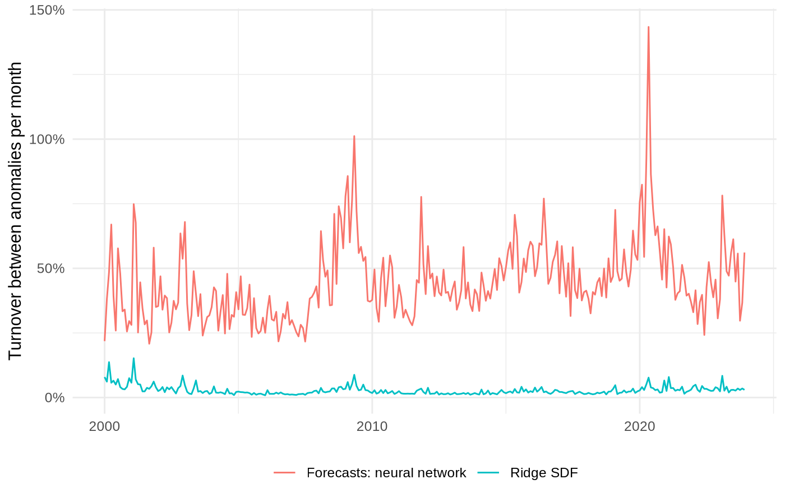

This exercise goes with [lecture 14](../slides/aef-14-neural-networks-and-learning-the-sdf.pdf) and, for the part on what the portfolios trade, with [lecture 15](../slides/aef-15-implementable-portfolios.pdf). The first part builds Chen–Pelger–Zhu light, a network that learns the SDF of the factor zoo itself, step by step. The second part compares the monthly turnover of portfolios with constant weights, such as the ridge SDF of [exercise 7](machine_learning.qmd), with the turnover of the forecast portfolios of [exercise 9](machine_learning_nonlinear.qmd). The last part asks you to beat the best model in the out-of-sample comparison of the lectures. The data are the long-short returns of the anomalies with complete returns from January 1973 to December 2023; the estimation sample runs until 1999, the test sample from 2000 to 2023.

## Learning the SDF: Chen–Pelger–Zhu light {#cpz-light}

Lecture 14 describes Chen–Pelger–Zhu light in words: two networks play a game in which the SDF network $\omega$ sets each anomaly's weight from its features, $M_{t+1} = 1 - \sum_{i=1}^{N} \omega(z_{i,t})\, F_{i,t+1}$, and the adversary $g$ picks managed portfolios $F_{i,t+1}\, g(z_{i,t})$ that this SDF prices badly. The lecture's numbers come from a search over 72 settings with 9 networks each, which took 2 hours and 14 minutes on 64 cores (`lecture-slides/factor-zoo/cpz_light.py` in the course repository). Here, you build the same algorithm step by step, in a smaller version that runs on a laptop in a few minutes:

- **One setting:** the inputs of the lecture's chosen setting (the features of each anomaly and its loadings on 10 principal components, no macro state), 32 instead of 128 neurons per hidden layer, no dropout instead of a dropout rate of 0.2, and 3 instead of 9 networks per ensemble.
- **Samples:** training 1974–1994, validation 1995–1999 (early stopping), test 2000–2023, as in lecture 14.
- **Software:** the package `torch` in R and PyTorch in Python, which compute the gradients of any loss by backpropagation. Neither is part of the course environment: add it to your copy of the course repository with `uvr add torch` (R; then run `torch::install_torch()` once, which downloads the library behind the package) or `uv add torch` (Python).

**Exercises:**

1.  **Inputs.** For each anomaly $i$ and month $t$, collect the features known before month $t$: last month's return, the mean return over the last 12 months (factor momentum) and the mean of all past returns since January 1973 (the historical mean). Add the anomaly's loadings on the first 10 principal components of the covariance matrix of the training months, which say how the anomaly moves with the others. Keep the months from January 1974, when 12 months of history exist, and standardize each of the 13 inputs with its mean and standard deviation in the training months. Store the inputs in an array with one row per month, one column per anomaly and one layer per input.
2.  **The SDF network.** Build a feed-forward network with two hidden layers of 32 neurons with the ReLU activation and one output, the weight $\omega_{i,t}$. The same network maps the 13 inputs of every anomaly to its weight.
3.  **The pricing errors.** Write a function that takes the weights, the returns and the instruments $g_{i,t}$ (an array with $D$ instruments per anomaly and month) and returns the mean squared pricing error over the $T$ months of a sample,
    $$
    L = \frac{1}{N} \sum_{i=1}^{N} \sum_{d=1}^{D} \bigg(\frac{1}{T} \sum_{t} M_{t+1} F_{i,t+1}\, g_{d}(z_{i,t})\bigg)^2, \qquad M_{t+1} = 1 - \sum_{j=1}^{N} \omega_{j,t} F_{j,t+1}.
    $$
    With $g = 1$, the moments are the unconditional ones of lecture 11, $E[M_{t+1} F_{i,t+1}] = 0$.
4.  **Training with early stopping.** Train the SDF network with the Adam optimizer (learning rate $10^{-3}$, weight decay $10^{-5}$) on the pricing errors of the training months, with all training months in every step (no mini-batches). After each step, compute the pricing errors of the validation months, keep the network with the smallest, and stop after 100 steps without a new smallest error, or after at most 2,000 steps. Train first with $g = 1$; the result is the feed-forward SDF of lecture 14.
5.  **The adversary.** Build a second network with the same inputs and 8 outputs; $g = \tanh(\cdot)$ of its outputs gives 8 instruments between $-1$ and $1$ per anomaly and month. In each of three rounds, train the adversary for 200 steps to *maximize* the pricing errors of the current SDF in the training months, then train the SDF network as in task 4, for at most 1,000 steps, on the unconditional moments and the 8 adversarial ones.
6.  **The out-of-sample comparison.** Train three pairs of networks, with the seeds 1, 2 and 3, and average their weights. Compute the annualized Sharpe ratios of the portfolio $\sum_i \omega_{i,t} F_{i,t+1}$ in the training, validation, estimation (both) and test months, for the feed-forward SDF (after the first step) and for Chen–Pelger–Zhu light (after the three rounds). How do they compare with the Sharpe ratios in the out-of-sample comparison of lecture 14, and with the ridge SDF?

**Solutions:**

The setup reads the long-short returns of [exercise 7](machine_learning.qmd), keeps the anomalies with complete returns from January 1973 to December 2023 and converts the returns from percent to decimals, as in [exercise 9](machine_learning_nonlinear.qmd). The dates split the months into the training (until 1994), validation (1995–1999) and test sample (from 2000), and `sharpe_ratio()` annualizes the Sharpe ratio of monthly returns.

::: {.panel-tabset group="language"}
## R
```{r}
#| label: r-sdf-data
library(tidyverse)
library(nanoparquet)

sample_start <- ymd("1973-01-01")
sample_end <- ymd("2023-12-31")
test_start <- ymd("2000-01-01")
validation_start <- ymd("1995-01-01")
months_per_year <- 12

anomalies <- read_parquet("data/osap_long_short_returns.parquet") |>
  mutate(date = floor_date(date, "month")) |>
  filter(between(date, sample_start, sample_end)) |>
  select(date, where(\(x) !anyNA(x)))
returns <- as.matrix(select(anomalies, -date)) / 100

sharpe_ratio <- function(x) mean(x) / sd(x) * sqrt(months_per_year)
```

## Python
```{python}
#| label: py-sdf-data
from datetime import date

import numpy as np
import polars as pl

sample_start = date(1973, 1, 1)
sample_end = date(2023, 12, 31)
test_start = date(2000, 1, 1)
validation_start = date(1995, 1, 1)
months_per_year = 12

anomalies = (
    pl.read_parquet("data/osap_long_short_returns.parquet")
    .with_columns(pl.col("date").dt.truncate("1mo"))
    .filter(pl.col("date").is_between(sample_start, sample_end))
)
complete = [
    c for c in anomalies.columns if c != "date" and anomalies[c].null_count() == 0
]
returns = anomalies.select(complete).to_numpy() / 100


def sharpe_ratio(x):
    return np.mean(x) / np.std(x, ddof=1) * np.sqrt(months_per_year)
```
:::

The return matrix has 612 months and 158 anomalies.

The inputs use the matrix `returns` of the setup, which starts in January 1973. In the arrays, row $t$ holds the return of month $t$ and the inputs known before it, so the weights of row $t$ multiply the returns of the same row. The loadings are the same in every month; the sign of each principal component is fixed so that its weights sum to a positive number, because the sign of an eigenvector is arbitrary and R and Python could otherwise return different signs.

::: {.panel-tabset group="language"}
## R
```{r}
#| label: r-cpz-inputs
library(torch)

momentum_months <- 12
n_components <- 10

n_months <- nrow(returns)
n_anomalies <- ncol(returns)
last_return <- matrix(NA, n_months, n_anomalies)
momentum <- matrix(NA, n_months, n_anomalies)
historical_mean <- matrix(NA, n_months, n_anomalies)
for (t in 2:n_months) {
  last_return[t, ] <- returns[t - 1, ]
  historical_mean[t, ] <- colMeans(returns[1:(t - 1), , drop = FALSE])
  if (t > momentum_months) {
    momentum[t, ] <- colMeans(returns[(t - momentum_months):(t - 1), ])
  }
}

# The months with 12 months of history, and the three samples
keep <- seq_len(n_months) > momentum_months
sdf_dates <- anomalies$date[keep]
sdf_returns <- returns[keep, ]
training_months <- sdf_dates < validation_start
validation_months <- sdf_dates >= validation_start & sdf_dates < test_start
test_months <- sdf_dates >= test_start

# Loadings on the principal components of the training months
components <- eigen(cov(sdf_returns[training_months, ]), symmetric = TRUE)
loadings <- components$vectors[, seq_len(n_components)]
loadings <- sweep(loadings, 2, sign(colSums(loadings)), `*`)

n_inputs <- 3 + n_components
inputs <- array(NA, c(sum(keep), n_anomalies, n_inputs))
inputs[,, 1] <- last_return[keep, ]
inputs[,, 2] <- momentum[keep, ]
inputs[,, 3] <- historical_mean[keep, ]
for (k in seq_len(n_components)) {
  inputs[,, 3 + k] <- matrix(
    loadings[, k],
    sum(keep),
    n_anomalies,
    byrow = TRUE
  )
}
for (k in seq_len(n_inputs)) {
  training_values <- inputs[training_months, , k]
  inputs[,, k] <- (inputs[,, k] - mean(training_values)) /
    sd(training_values)
}

# torch works with tensors of 32-bit numbers
returns_tensor <- torch_tensor(sdf_returns, dtype = torch_float())
inputs_tensor <- torch_tensor(inputs, dtype = torch_float())
training_returns <- returns_tensor[which(training_months), ]
training_inputs <- inputs_tensor[which(training_months), , ]
validation_returns <- returns_tensor[which(validation_months), ]
validation_inputs <- inputs_tensor[which(validation_months), , ]
```

## Python
```{python}
#| label: py-cpz-inputs
import torch
from torch import nn

momentum_months = 12
n_components = 10

n_months, n_anomalies = returns.shape
last_return = np.full_like(returns, np.nan)
momentum = np.full_like(returns, np.nan)
historical_mean = np.full_like(returns, np.nan)
for t in range(1, n_months):
    last_return[t] = returns[t - 1]
    historical_mean[t] = returns[:t].mean(axis=0)
    if t >= momentum_months:
        momentum[t] = returns[t - momentum_months : t].mean(axis=0)

# The months with 12 months of history, and the three samples
keep = np.arange(n_months) >= momentum_months
sdf_dates = anomalies["date"].to_numpy()[keep]
sdf_returns = returns[keep]
training_months = sdf_dates < np.datetime64(validation_start)
validation_months = (sdf_dates >= np.datetime64(validation_start)) & (
    sdf_dates < np.datetime64(test_start)
)
test_months = sdf_dates >= np.datetime64(test_start)

# Loadings on the principal components of the training months
values, vectors = np.linalg.eigh(np.cov(sdf_returns[training_months], rowvar=False))
loadings = vectors[:, np.argsort(values)[::-1][:n_components]]
loadings = loadings * np.sign(loadings.sum(axis=0))

inputs = np.concatenate(
    [
        np.stack([last_return, momentum, historical_mean], axis=2)[keep],
        np.broadcast_to(loadings, (keep.sum(), n_anomalies, n_components)),
    ],
    axis=2,
)
n_inputs = inputs.shape[2]
training_values = inputs[training_months]
inputs = (inputs - training_values.mean(axis=(0, 1))) / training_values.std(
    axis=(0, 1), ddof=1
)

# PyTorch works with tensors of 32-bit numbers
returns_tensor = torch.tensor(sdf_returns, dtype=torch.float32)
inputs_tensor = torch.tensor(inputs, dtype=torch.float32)
training_returns = returns_tensor[training_months]
training_inputs = inputs_tensor[training_months]
validation_returns = returns_tensor[validation_months]
validation_inputs = inputs_tensor[validation_months]
```
:::

The array has 600 months, from January 1974 to December 2023, 158 anomalies and 13 inputs: 252 training months, 60 validation months and 288 test months.

Both networks have the same shape: two hidden layers with the ReLU activation, applied to the last dimension of the input array, so that the same weights serve every anomaly and month. The pricing errors follow the formula of task 3 line by line: the SDF of each month, the managed portfolios $M_{t+1} F_{i,t+1}\, g_d(z_{i,t})$, their means over the months, and the mean over the anomalies of the summed squares.

::: {.panel-tabset group="language"}
## R
```{r}
#| label: r-cpz-networks
sdf_hidden_units <- 32

feed_forward <- function(n_outputs) {
  nn_sequential(
    nn_linear(n_inputs, sdf_hidden_units),
    nn_relu(),
    nn_linear(sdf_hidden_units, sdf_hidden_units),
    nn_relu(),
    nn_linear(sdf_hidden_units, n_outputs)
  )
}

pricing_loss <- function(weights, returns, instruments) {
  sdf <- 1 - (weights * returns)$sum(dim = 2)
  managed <- sdf$view(c(-1, 1, 1)) * returns$unsqueeze(3) * instruments
  moments <- managed$mean(dim = 1)
  (moments^2)$sum(dim = 2)$mean()
}
```

## Python
```{python}
#| label: py-cpz-networks
sdf_hidden_units = 32


def feed_forward(n_outputs):
    return nn.Sequential(
        nn.Linear(n_inputs, sdf_hidden_units),
        nn.ReLU(),
        nn.Linear(sdf_hidden_units, sdf_hidden_units),
        nn.ReLU(),
        nn.Linear(sdf_hidden_units, n_outputs),
    )


def pricing_loss(weights, returns, instruments):
    sdf = 1 - (weights * returns).sum(dim=1)
    managed = sdf[:, None, None] * returns[:, :, None] * instruments
    moments = managed.mean(dim=0)
    return (moments**2).sum(dim=1).mean()
```
:::

Training uses all training months in every step, so each step of Adam follows the gradient of the full pricing loss. The instruments are a function of the inputs: `unconditional()` returns $g = 1$, and in the rounds the instruments also include the adversary's. `fit_sdf()` computes them once for the training and the validation months, trains until the validation pricing errors have not improved for 100 steps, and goes back to the best network. In R, `$` calls the methods of a network or an optimizer; `with_no_grad()` (R) and `torch.no_grad()` (Python) switch off the gradients where we only evaluate.

::: {.panel-tabset group="language"}
## R
```{r}
#| label: r-cpz-training
learning_rate <- 1e-3
weight_decay <- 1e-5
max_steps <- 2000
patience <- 100

unconditional <- function(inputs) torch_ones(inputs$size(1), inputs$size(2), 1)

fit_sdf <- function(sdf_network, optimizer, instruments, max_steps) {
  training_instruments <- instruments(training_inputs)
  validation_instruments <- instruments(validation_inputs)
  best_loss <- Inf
  steps_without_improvement <- 0
  for (step in seq_len(max_steps)) {
    optimizer$zero_grad()
    weights <- sdf_network(training_inputs)$squeeze(3)
    loss <- pricing_loss(weights, training_returns, training_instruments)
    loss$backward()
    optimizer$step()
    # Early stopping on the pricing errors of the validation months
    validation_loss <- with_no_grad({
      weights <- sdf_network(validation_inputs)$squeeze(3)
      pricing_loss(weights, validation_returns, validation_instruments)$item()
    })
    if (validation_loss < best_loss) {
      best_loss <- validation_loss
      best_state <- lapply(sdf_network$state_dict(), \(x) x$detach()$clone())
      steps_without_improvement <- 0
    } else {
      steps_without_improvement <- steps_without_improvement + 1
      if (steps_without_improvement > patience) break
    }
  }
  sdf_network$load_state_dict(best_state)
  step
}
```

## Python
```{python}
#| label: py-cpz-training
learning_rate = 1e-3
weight_decay = 1e-5
max_steps = 2000
patience = 100


def unconditional(inputs):
    return torch.ones(inputs.shape[0], inputs.shape[1], 1)


def fit_sdf(sdf_network, optimizer, instruments, max_steps):
    training_instruments = instruments(training_inputs)
    validation_instruments = instruments(validation_inputs)
    best_loss, steps_without_improvement = np.inf, 0
    for step in range(1, max_steps + 1):
        optimizer.zero_grad()
        weights = sdf_network(training_inputs).squeeze(2)
        loss = pricing_loss(weights, training_returns, training_instruments)
        loss.backward()
        optimizer.step()
        # Early stopping on the pricing errors of the validation months
        with torch.no_grad():
            weights = sdf_network(validation_inputs).squeeze(2)
            validation_loss = pricing_loss(
                weights, validation_returns, validation_instruments
            ).item()
        if validation_loss < best_loss:
            best_loss = validation_loss
            best_state = {k: v.clone() for k, v in sdf_network.state_dict().items()}
            steps_without_improvement = 0
        else:
            steps_without_improvement += 1
            if steps_without_improvement > patience:
                break
    sdf_network.load_state_dict(best_state)
    return step
```
:::

`train_sdf()` plays the game for one seed. The seed fixes the random starting weights of both networks; R and Python draw them with the same random number generator of the library behind `torch`, so the same seed gives the same starting networks in both languages. After the first fit, the function stores the weights of the feed-forward SDF. Each round then trains the adversary on the negative pricing loss, which maximizes the pricing errors, and fits the SDF network again on the unconditional and the adversarial moments.

::: {.panel-tabset group="language"}
## R
```{r}
#| label: r-cpz-adversary
n_instruments <- 8
n_rounds <- 3
adversary_steps <- 200
max_steps_round <- 1000

train_sdf <- function(seed) {
  torch_manual_seed(seed)
  sdf_network <- feed_forward(1)
  adversary <- feed_forward(n_instruments)
  optimizer <- optim_adam(
    sdf_network$parameters,
    lr = learning_rate,
    weight_decay = weight_decay
  )
  adversary_optimizer <- optim_adam(adversary$parameters, lr = learning_rate)
  adversarial <- function(inputs) {
    with_no_grad({
      torch_cat(
        list(unconditional(inputs), torch_tanh(adversary(inputs))),
        dim = 3
      )
    })
  }

  steps <- fit_sdf(sdf_network, optimizer, unconditional, max_steps)
  feed_forward_weights <- with_no_grad({
    as_array(sdf_network(inputs_tensor)$squeeze(3))
  })
  for (adversarial_round in seq_len(n_rounds)) {
    weights <- with_no_grad(sdf_network(training_inputs)$squeeze(3))
    for (step in seq_len(adversary_steps)) {
      adversary_optimizer$zero_grad()
      instruments <- torch_tanh(adversary(training_inputs))
      loss <- -pricing_loss(weights, training_returns, instruments)
      loss$backward()
      adversary_optimizer$step()
    }
    steps <- c(
      steps,
      fit_sdf(sdf_network, optimizer, adversarial, max_steps_round)
    )
  }
  list(
    feed_forward = feed_forward_weights,
    adversarial = with_no_grad({
      as_array(sdf_network(inputs_tensor)$squeeze(3))
    }),
    steps = steps
  )
}
```

## Python
```{python}
#| label: py-cpz-adversary
n_instruments = 8
n_rounds = 3
adversary_steps = 200
max_steps_round = 1000


def train_sdf(seed):
    torch.manual_seed(seed)
    sdf_network = feed_forward(1)
    adversary = feed_forward(n_instruments)
    optimizer = torch.optim.Adam(
        sdf_network.parameters(), lr=learning_rate, weight_decay=weight_decay
    )
    adversary_optimizer = torch.optim.Adam(adversary.parameters(), lr=learning_rate)

    def adversarial(inputs):
        with torch.no_grad():
            return torch.cat(
                [unconditional(inputs), torch.tanh(adversary(inputs))], dim=2
            )

    steps = [fit_sdf(sdf_network, optimizer, unconditional, max_steps)]
    with torch.no_grad():
        feed_forward_weights = sdf_network(inputs_tensor).squeeze(2).numpy()
    for _ in range(n_rounds):
        with torch.no_grad():
            weights = sdf_network(training_inputs).squeeze(2)
        for _ in range(adversary_steps):
            adversary_optimizer.zero_grad()
            instruments = torch.tanh(adversary(training_inputs))
            loss = -pricing_loss(weights, training_returns, instruments)
            loss.backward()
            adversary_optimizer.step()
        steps.append(fit_sdf(sdf_network, optimizer, adversarial, max_steps_round))
    with torch.no_grad():
        adversarial_weights = sdf_network(inputs_tensor).squeeze(2).numpy()
    return {
        "feed_forward": feed_forward_weights,
        "adversarial": adversarial_weights,
        "steps": steps,
    }
```
:::

The ensemble averages the weights of the three seeds, as `cpz_light.py` does with nine. `sdf_sharpe()` computes the Sharpe ratios of the SDF portfolio in the four samples with `sharpe_ratio()` of the setup.

::: {.panel-tabset group="language"}
## R
```{r}
#| label: r-cpz-comparison
n_sdf_networks <- 3

sdf_fits <- map(seq_len(n_sdf_networks), train_sdf)
map(sdf_fits, "steps")

sdf_sharpe <- function(weights) {
  portfolio <- rowSums(weights * sdf_returns)
  c(
    training = sharpe_ratio(portfolio[training_months]),
    validation = sharpe_ratio(portfolio[validation_months]),
    estimation = sharpe_ratio(portfolio[!test_months]),
    test = sharpe_ratio(portfolio[test_months])
  )
}
ensemble <- function(model) {
  reduce(map(sdf_fits, model), `+`) / n_sdf_networks
}
rbind(
  feed_forward_sdf = sdf_sharpe(ensemble("feed_forward")),
  cpz_light = sdf_sharpe(ensemble("adversarial"))
)
```

## Python
```{python}
#| label: py-cpz-comparison
n_sdf_networks = 3

sdf_fits = [train_sdf(seed) for seed in range(1, n_sdf_networks + 1)]
print([fit["steps"] for fit in sdf_fits])


def sdf_sharpe(weights):
    portfolio = (weights * sdf_returns).sum(axis=1)
    return {
        "training": sharpe_ratio(portfolio[training_months]),
        "validation": sharpe_ratio(portfolio[validation_months]),
        "estimation": sharpe_ratio(portfolio[~test_months]),
        "test": sharpe_ratio(portfolio[test_months]),
    }


def ensemble(model):
    return np.mean([fit[model] for fit in sdf_fits], axis=0)


pl.DataFrame(
    [
        {"model": "feed_forward_sdf", **sdf_sharpe(ensemble("feed_forward"))},
        {"model": "cpz_light", **sdf_sharpe(ensemble("adversarial"))},
    ]
)
```
:::

The R code prints the number of steps of each seed's four fits (the feed-forward SDF and the three rounds) and the Sharpe ratios:

```{.default .code-output}
#> [[1]]
#> [1] 121 102 102 102
#>
#> [[2]]
#> [1] 181 102 102 102
#>
#> [[3]]
#> [1] 151 102 102 313
#>
#>                  training validation estimation     test
#> feed_forward_sdf 3.496114   3.107825   3.404506 1.092948
#> cpz_light        4.928697   4.296338   4.765241 1.683095
```

The Python code prints the same steps, except 318 instead of 313 in the last round of seed 3. The table compares the Sharpe ratios of both languages with the lecture:

| SDF | Sharpe ratio 1974–1994 (training) | 1995–1999 (validation) | 1974–1999 (estimation) | 2000–2023 (test) |
|:----|----:|----:|----:|----:|
| Feed-forward SDF, R | 3.50 | 3.11 | 3.40 | 1.09 |
| Feed-forward SDF, Python | 3.50 | 3.11 | 3.40 | 1.09 |
| Chen–Pelger–Zhu light, R | 4.93 | 4.30 | 4.77 | 1.68 |
| Chen–Pelger–Zhu light, Python | 4.93 | 4.30 | 4.77 | 1.69 |
| Lecture 14, same setting with 9 networks: feed-forward SDF | 3.77 | 3.25 | 3.62 | 1.05 |
| Lecture 14, same setting with 9 networks: Chen–Pelger–Zhu light | 5.58 | 4.86 | 5.36 | 1.89 |
| Ridge SDF, constant weights ([exercise 7](machine_learning.qmd)) | | | | 2.89 |

The two languages agree. With the same seed, R and Python start from the same networks: the outputs of the starting SDF networks agree to all digits. The weights of the feed-forward SDFs differ by less than 0.00001 after training, so their Sharpe ratios agree to two decimals in all four samples. Chen–Pelger–Zhu light agrees to two decimals except in the test sample, 1.68 in R and 1.69 in Python: in the last round of the third seed, R stops after 313 steps and Python after 318, because tiny rounding differences between the two libraries add up over more than a thousand steps. The weights of the two ensembles still have a correlation of 0.99998. On another computer, with an ARM processor, Python also stops after 313 steps and gives 1.68, so the last digit depends on the computer as much as on the language. On a machine with 4 cores, the three seeds took 67 seconds in R (`torch` 0.17.0) and 48 seconds in Python (PyTorch 2.15.0).

As in lecture 14, the adversary helps: Chen–Pelger–Zhu light earns 1.68 in the test sample, the feed-forward SDF 1.09, and the validation sample ranks the two the same way (4.30 against 3.11). The small version stays below the lecture's 1.89 and far below the ridge SDF. The steps show why one setting with three networks is noisy. For seeds 1 and 2, the validation pricing errors rise right after the first step of every round, so early stopping keeps the network after that step, and Chen–Pelger–Zhu light hardly differs from the feed-forward SDF (test Sharpe ratios of 0.91 and 1.16 for both). Only for seed 3 does the last round train for more than 300 steps, which lifts the test Sharpe ratio of this network from 1.10 to 1.83. Averaging nine networks, as in the lecture, makes the result depend less on one lucky seed.

## What the portfolios trade {#turnover}

**Exercises:**

7.  Compute the monthly turnover between anomalies, as in lecture 15. Scale each month's weights to a gross position of one, $\sum_i |\omega_{i,t}| = 1$. During month $t$, the weights drift with the returns to $\omega_{i,t}(1 + r_{i,t})$, again scaled to a gross position of one; call these drifted weights $\tilde\omega_{i,t}$. The turnover in month $t+1$ is $\sum_i |\omega_{i,t+1} - \tilde\omega_{i,t}|$. Compute the average turnover in the test sample for two portfolios with constant weights, 1/N and the ridge SDF, and for the forecast portfolios of OLS and of the network of [exercise 9](machine_learning_nonlinear.qmd).
8.  Plot the monthly turnover of the ridge SDF and of the network portfolio from 2000 to 2023. Why does a portfolio with constant weights trade at all, and why does the forecast portfolio trade so much more?
9.  Suppose every trade between anomalies costs a fixed fraction of the amount traded. What does the turnover imply for the returns of the ridge SDF and of the network portfolio after trading costs? Which trading costs does this turnover leave out?

**Solutions:**

The turnover compares the ridge SDF of [exercise 7](machine_learning.qmd) with the forecast portfolios of [exercise 9](machine_learning_nonlinear.qmd). The setup repeats the parts of exercise 9 that the comparison needs: the panel with the seven predictors, the forecasts of OLS and of the ensemble of five networks with the weight decay of 300 that exercise 9 chooses, the mean-variance weights of the forecasts, and the weights of the ridge SDF. If the objects of exercise 9 are still in your session, skip the setup. On a machine with 4 cores, the five networks took 40 seconds in R and 46 seconds in Python.

::: {.panel-tabset group="language"}
## R
```{r}
#| label: r-turnover-setup
library(tidymodels)

macro_names <- c("dp", "tbl", "tms", "dfy", "svar")
features <- c("ret_lag_1", "momentum_12", macro_names)
hidden_units <- 5
chosen_decay <- 300 # The weight decay that exercise 9 chooses
n_networks <- 5
epochs <- 500
ridge_lambda <- 1e-4

estimation_returns <- returns[anomalies$date < test_start, ]

# Macro predictors of month t - 1 are known when month t starts
macro <- read_parquet("data/macro_predictors.parquet") |>
  transmute(date = date %m+% months(1), across(all_of(macro_names))) |>
  mutate(across(all_of(macro_names), \(x) {
    (x - mean(x[date < test_start])) / sd(x[date < test_start])
  }))

panel <- anomalies |>
  pivot_longer(-date, names_to = "anomaly", values_to = "ret") |>
  mutate(ret = ret / 100) |>
  arrange(anomaly, date) |>
  mutate(
    ret_lag_1 = lag(ret),
    momentum_12 = slider::slide_dbl(
      lag(ret),
      mean,
      .before = 11,
      .complete = TRUE
    ),
    .by = anomaly
  ) |>
  left_join(macro, join_by(date)) |>
  drop_na()
train <- filter(panel, date < test_start)

# The predictors standardized with the training sample, and the return in
# units of its standard deviation there
ret_sd <- sd(train$ret)
scaled_panel <- panel |>
  mutate(
    across(all_of(features), \(x) {
      (x - mean(x[date < test_start])) / sd(x[date < test_start])
    }),
    ret_scaled = ret / ret_sd
  )
scaled_train <- filter(scaled_panel, date < test_start)

# The forecasts of the five networks, averaged, and of OLS
network_model <- mlp(
  hidden_units = hidden_units,
  penalty = chosen_decay,
  epochs = epochs
) |>
  set_engine("nnet") |>
  set_mode("regression")
network_workflow <- workflow() |>
  add_variables(outcomes = ret_scaled, predictors = all_of(features)) |>
  add_model(network_model)
network_forecasts <- map(seq_len(n_networks), \(seed) {
  set.seed(seed)
  network_fit <- fit(network_workflow, scaled_train)
  predict(network_fit, scaled_panel)$.pred * ret_sd
})
network_forecast <- reduce(network_forecasts, `+`) / n_networks
ols_fit <- lm(reformulate(features, response = "ret"), data = train)
ols_forecast <- predict(ols_fit, panel)

# The forecasts as a matrix of months and anomalies, and their mean-variance
# weights
panel_dates <- sort(unique(panel$date))
to_matrix <- function(values) {
  panel |>
    transmute(date, anomaly, value = values) |>
    pivot_wider(names_from = anomaly, values_from = value) |>
    arrange(date) |>
    select(all_of(colnames(returns))) |>
    as.matrix()
}
panel_returns <- to_matrix(panel$ret)
covariance <- cov(estimation_returns)
forecast_weights <- function(forecast) {
  to_matrix(forecast) %*% solve(covariance + ridge_lambda * diag(ncol(returns)))
}

# The ridge SDF of exercise 7
ridge_weights <- solve(
  crossprod(estimation_returns) +
    nrow(estimation_returns) * ridge_lambda * diag(ncol(returns)),
  colSums(estimation_returns)
)
```

## Python
```{python}
#| label: py-turnover-setup
from mizani.formatters import percent_format
from plotnine import *
from sklearn.linear_model import LinearRegression
from sklearn.neural_network import MLPRegressor

macro_names = ["dp", "tbl", "tms", "dfy", "svar"]
features = ["ret_lag_1", "momentum_12", *macro_names]
hidden_units = 5
chosen_decay = 300  # The weight decay that exercise 9 chooses
n_networks = 5
max_iterations = 500
ridge_lambda = 1e-4

estimation_returns = returns[(anomalies["date"] < test_start).to_numpy()]

# Macro predictors of month t - 1 are known when month t starts
in_estimation = pl.col("date") < test_start
macro = (
    pl.read_parquet("data/macro_predictors.parquet")
    .select(pl.col("date").dt.offset_by("1mo"), *macro_names)
    .with_columns(
        (
            (pl.col(c) - pl.col(c).filter(in_estimation).mean())
            / pl.col(c).filter(in_estimation).std()
        ).alias(c)
        for c in macro_names
    )
)

panel = (
    anomalies.select("date", *complete)
    .unpivot(index="date", variable_name="anomaly", value_name="ret")
    .with_columns(pl.col("ret") / 100)
    .sort("anomaly", "date")
    .with_columns(
        ret_lag_1=pl.col("ret").shift(1).over("anomaly"),
        momentum_12=pl.col("ret").shift(1).rolling_mean(12).over("anomaly"),
    )
    .join(macro, on="date", how="left")
    .drop_nulls()
)
train = panel.filter(in_estimation)

# The predictors standardized with the training sample, and the return in
# units of its standard deviation there
ret_sd = train["ret"].std()
scaled_panel = panel.with_columns(
    [
        (pl.col(c) - pl.col(c).filter(in_estimation).mean())
        / pl.col(c).filter(in_estimation).std()
        for c in features
    ],
    ret_scaled=pl.col("ret") / ret_sd,
)
scaled_train = scaled_panel.filter(in_estimation)

# The forecasts of the five networks, averaged, and of OLS
x_train = scaled_train.select(features).to_numpy()
y_train = scaled_train["ret_scaled"].to_numpy()
network_forecasts = []
for seed in range(1, n_networks + 1):
    network = MLPRegressor(
        hidden_layer_sizes=(hidden_units,),
        activation="logistic",
        solver="lbfgs",
        alpha=chosen_decay,
        max_iter=max_iterations,
        random_state=seed,
    )
    network.fit(x_train, y_train)
    network_forecasts.append(
        network.predict(scaled_panel.select(features).to_numpy()) * ret_sd
    )
network_forecast = np.mean(network_forecasts, axis=0)
ols_forecast = (
    LinearRegression()
    .fit(train.select(features).to_numpy(), train["ret"].to_numpy())
    .predict(panel.select(features).to_numpy())
)

# The forecasts as a matrix of months and anomalies, and their mean-variance
# weights
panel_dates = panel["date"].unique().sort().to_numpy()


def to_matrix(values):
    return (
        panel.select("date", "anomaly", value=pl.Series(values))
        .pivot(on="anomaly", index="date", values="value")
        .sort("date")
        .select(complete)
        .to_numpy()
    )


panel_returns = to_matrix(panel["ret"])
covariance = np.cov(estimation_returns, rowvar=False)


def forecast_weights(forecast):
    return to_matrix(forecast) @ np.linalg.inv(
        covariance + ridge_lambda * np.eye(len(complete))
    )


# The ridge SDF of exercise 7
ridge_weights = np.linalg.solve(
    estimation_returns.T @ estimation_returns
    + estimation_returns.shape[0] * ridge_lambda * np.eye(len(complete)),
    estimation_returns.sum(axis=0),
)
```
:::

The function `turnover()` returns one value per month of the panel; the first month has no previous weights.

::: {.panel-tabset group="language"}
## R
```{r}
#| label: r-turnover
turnover <- function(weights) {
  gross <- weights / rowSums(abs(weights))
  drifted <- gross[-nrow(gross), ] * (1 + panel_returns[-nrow(gross), ])
  drifted <- drifted / rowSums(abs(drifted))
  c(NA, rowSums(abs(gross[-1, ] - drifted)))
}

constant_weights <- function(w) {
  matrix(w, nrow = length(panel_dates), ncol = length(w), byrow = TRUE)
}
portfolio_weights <- list(
  "1/N" = constant_weights(rep(1 / ncol(returns), ncol(returns))),
  "Ridge SDF" = constant_weights(ridge_weights),
  "Forecasts: OLS" = forecast_weights(ols_forecast),
  "Forecasts: neural network" = forecast_weights(network_forecast)
)
monthly_turnover <- map(portfolio_weights, turnover) |>
  as_tibble() |>
  mutate(date = panel_dates) |>
  filter(date >= test_start)

monthly_turnover |>
  summarize(across(-date, mean))
```

## Python
```{python}
#| label: py-turnover
def turnover(weights):
    gross = weights / np.abs(weights).sum(axis=1, keepdims=True)
    drifted = gross[:-1] * (1 + panel_returns[:-1])
    drifted = drifted / np.abs(drifted).sum(axis=1, keepdims=True)
    return np.concatenate([[np.nan], np.abs(gross[1:] - drifted).sum(axis=1)])


def constant_weights(w):
    return np.tile(w, (len(panel_dates), 1))


portfolio_weights = {
    "1/N": constant_weights(np.full(len(complete), 1 / len(complete))),
    "Ridge SDF": constant_weights(ridge_weights),
    "Forecasts: OLS": forecast_weights(ols_forecast),
    "Forecasts: neural network": forecast_weights(network_forecast),
}
monthly_turnover = (
    pl.DataFrame({name: turnover(w) for name, w in portfolio_weights.items()})
    .with_columns(date=pl.Series(panel_dates))
    .filter(pl.col("date") >= test_start)
)

monthly_turnover.drop("date").mean()
```
:::

The code prints the average turnover of each portfolio:

| Portfolio | Turnover between anomalies per month, 2000–2023 |
|:----------|----:|
| 1/N | 2.8% |
| Ridge SDF | 2.8% |
| Forecasts: OLS | 52.4% |
| Forecasts: neural network | 44.7% (R), 44.9% (Python) |

The portfolios with constant weights trade less than 3% of their gross position a month, the forecast portfolios 16 to 19 times as much. Lecture 15 shows the same numbers, rounded to 3%, 52% and 45%.

::: {.panel-tabset group="language"}
## R
```{r}
#| label: r-plot-turnover
monthly_turnover |>
  select(date, `Ridge SDF`, `Forecasts: neural network`) |>
  pivot_longer(-date, names_to = "portfolio", values_to = "turnover") |>
  ggplot(aes(x = date, y = turnover, color = portfolio)) +
  geom_line() +
  scale_y_continuous(labels = scales::percent) +
  labs(x = NULL, y = "Turnover between anomalies per month", color = NULL) +
  theme(legend.position = "bottom")
```

## Python
```{python}
#| label: py-plot-turnover
(
    ggplot(
        monthly_turnover.select(
            "date", "Ridge SDF", "Forecasts: neural network"
        ).unpivot(index="date", variable_name="portfolio", value_name="turnover"),
        aes(x="date", y="turnover", color="portfolio"),
    )
    + geom_line()
    + scale_x_date(date_labels="%Y")
    + scale_y_continuous(labels=percent_format())
    + labs(x="", y="Turnover between anomalies per month", color="")
    + theme(legend_position="bottom")
)
```
:::

{fig-alt="Two lines of monthly turnover from 2000 to 2023: the ridge SDF stays below 15% in every month, the forecast portfolio of the neural network moves between about 20% and 80% with peaks of 101% in May 2009 and 143% in May 2020."}

A portfolio with constant weights trades only because the anomalies earn different returns. After a month, the winners have a larger share of the portfolio than their target weight, so rebalancing sells part of the winners and buys the losers. The ridge SDF trades most after months in which the returns of the anomalies differ the most, at most 15% in February 2001.

The forecast portfolio sets new weights every month. Last month's return and the average return over the last 12 months enter the forecasts, and both change every month; the mean-variance weights then react strongly to the changes in the expected returns. Its turnover never falls below 20% a month and peaks in May 2009 (101% in R, 103% in Python) and May 2020 (143% and 146%), during the financial crisis and the first months of the pandemic.

If every unit traded costs a fraction $c$, a portfolio with a gross position of one loses $c$ times its turnover each month. At the same $c$, the network portfolio pays about 16 times as much as the ridge SDF. At 10 bps, the cost of the trading game (lecture 5), it loses about 0.54% of its gross position a year, against 0.03% for the ridge SDF; at 50 bps, it loses 2.7% a year, against 0.17%. The forecast portfolio has the lower Sharpe ratio already before costs, and the costs widen the gap.

This turnover leaves out the trades inside each anomaly. Every long-short portfolio is itself rebalanced each month, and the returns from Open Source Asset Pricing are before these costs. Both kinds of portfolio pay them on top of the trades between anomalies. Lecture 15 discusses portfolios that take trading costs into account when they choose the weights.

## Beat the best model {#beat-the-best-model}

Can you beat the best model in the out-of-sample comparison of the lectures? Use any method from the course on the factor zoo, tuned with the estimation sample only, and compute the annualized Sharpe ratio of your SDF portfolio in the test sample.

**Submit by Sunday 25 April:** the kind of method you used and the Sharpe ratios of your SDF portfolio in the test and the estimation sample: [submission form](https://eumel.tail81c88a.ts.net:10000/survey?id=aef27-ex08-scoreboard). The next lecture adds the results of the whole class to the out-of-sample comparison.
