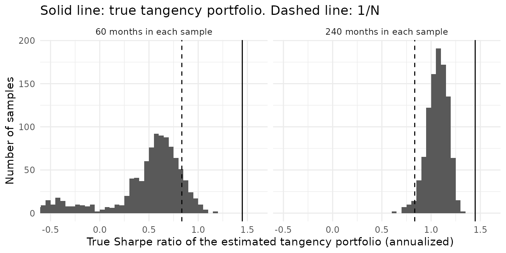
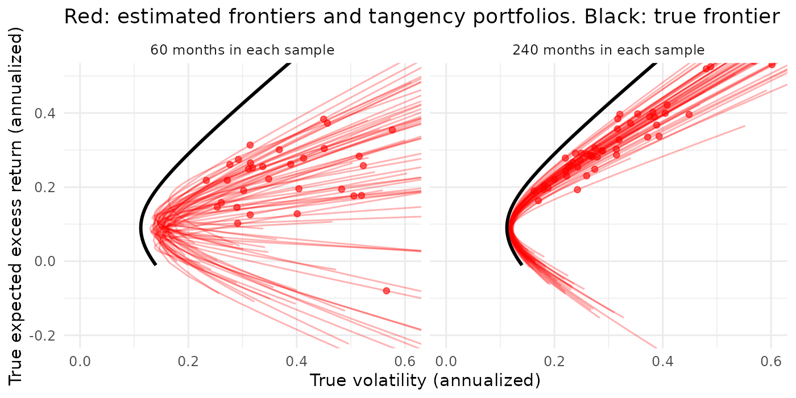

These exercises start with the portfolio choice problem of a mean-variance investor and then ask how much of the theory survives once the inputs are estimated.

## Portfolio choice problems {#portfolio-choice-problems}

**Exercises:**

1. Download the adjusted daily prices of today's Dow Jones constituents from January 2000 to December 2025 and compute *monthly* returns. Keep the stocks with a return in every month. Hint: `download_data()` from `tidyfinance` downloads both the constituents (`domain = "Index Constituents"`) and the prices (`domain = "Stock Prices"`).
2. Compute the historical average returns and the sample variance-covariance matrix.
3. Compute the minimum variance portfolio weights and the portfolio volatility and average returns.
4. Visualize the mean-variance efficient frontier. For that, first, compute an efficient portfolio, for instance the one with three times the expected return of the minimum variance portfolio. Then use the two-fund separation theorem to compute the location of a grid of combinations of the minimum variance portfolio and the efficient portfolio on the mean-volatility diagram which has (annualized) volatility on the $x$ axis and (annualized) expected returns on the $y$ axis. Indicate the location of the individual assets on the mean-volatility diagram as well.
5. Add a risk-free asset: use the average one-month T-bill rate from 2000 to 2025 (`risk_free` in `factors_ff3_monthly.parquet`) as the risk-free rate. Compute the tangency portfolio, its annualized expected return, volatility and Sharpe ratio, and draw the capital market line into the figure.

**Solutions:** Tasks 1 to 4 are solved and described in detail in the book chapter [Modern portfolio theory](https://www.tidy-finance.org/chapters/modern-portfolio-theory.html), with data until 2024. The slides of [lecture 2](../slides/aef-02-mean-variance-optimization.pdf) show the code for all five tasks in R and Python, and the results.

## Equivalence between certainty equivalent maximization and minimum variance optimization {#equivalence-between-certainty-equivalent-maximization-and-minimum-variance-optimization}

In [lecture 2](../slides/aef-02-mean-variance-optimization.pdf) (slide "Mean-variance preferences"), I state that an investor with a quadratic utility function with a certainty equivalent $$\max_w CE(w) = \omega'\mu - \frac{\gamma}{2} \omega'\Sigma \omega \text{ s.t. } \iota'\omega = 1$$
faces an equivalent optimization problem to a framework where portfolio weights are chosen to minimize volatility given a pre-specified level of expected returns
$$
\min_w \omega'\Sigma \omega \text{ s.t. } \omega'\mu = \bar\mu \text{ and } \iota'\omega = 1
$$

Note the differences: In the first case, the investor has a (known) risk aversion $\gamma$ which determines her optimal balance between risk ($\omega'\Sigma\omega)$ and return ($\mu'\omega$). In the second case, the investor has a target return she wants to achieve while minimizing the volatility. Intuitively, both approaches are closely connected if we consider that the risk aversion $\gamma$ determines the desirable return $\bar\mu$. More risk-averse investors (higher $\gamma$) will choose a lower target return to keep their volatility level down. The efficient frontier then spans all possible portfolios depending on the risk aversion $\gamma$, starting from the minimum variance portfolio ($\gamma = \infty$).

**Exercises:** Prove that the optimal portfolio weights are equivalent in both cases.

**Solutions:** The proofs are provided in the [Proofs](https://www.tidy-finance.org/chapters/proofs.html) appendix of Tidy Finance.

## Estimation uncertainty {#estimation-uncertainty}

[Lecture 3](../slides/aef-03-estimation-uncertainty.pdf) asks how much of the theory survives once $\mu$ and $\Sigma$ are estimated. Lecture 3 runs two experiments with the Dow Jones stocks from above: a simulation in which the true parameters are known, and a backtest with rolling windows. The following exercise reproduces the simulation; the backtest is a separate exercise, [Backtesting portfolio strategies](backtesting.qmd). Both use monthly *excess* returns: the returns minus the one-month T-bill rate, `risk_free` in `factors_ff3_monthly.parquet`.

### Estimated portfolios, true outcomes {#estimated-portfolios-true-outcomes}

**Exercises:**

1. Compute the monthly excess returns of the Dow Jones stocks from January 2000 to December 2025. In this exercise, their sample mean $\mu_0$ and sample covariance matrix $\Sigma_0$ are the *true* parameters. Compute the annualized Sharpe ratio of the true tangency portfolio, $\sqrt{12\,\mu_0'\Sigma_0^{-1}\mu_0}$, and of the $1/N$ portfolio.
2. Write a function that draws $T$ months of returns from the multivariate normal distribution $N(\mu_0, \Sigma_0)$ and estimates $\hat\mu$ and $\hat\Sigma$ from the draws. Compute the plug-in tangency portfolio $\hat\omega \propto \hat\Sigma^{-1}\hat\mu$ and evaluate it with the true parameters: which expected excess return, volatility and Sharpe ratio does an investor who holds $\hat\omega$ really get?
3. Repeat this 1,000 times for $T = 60$ and 1,000 times for $T = 240$ months. Plot the true Sharpe ratios of the estimated tangency portfolios in a histogram, with the Sharpe ratios of the true tangency portfolio and of $1/N$ as vertical lines. Which share of the estimated tangency portfolios does worse than $1/N$?
4. For the first 50 samples of each length, compute the estimated efficient frontier and evaluate it with the true parameters. Plot these frontiers together with the true efficient frontier in a diagram with the true volatility on the $x$ axis and the true expected excess return on the $y$ axis (both annualized). Why do all estimated frontiers lie inside the true one?

**Solutions:**

The solution uses the following packages and constants: the sample period, the number of months in each simulated sample, the number of samples for each length, and the number of samples whose frontiers the figure shows.

::: {.panel-tabset group="language"}
## R

```{r}
#| label: r-setup-estimation-uncertainty
library(tidyverse)
library(tidyfinance)
library(nanoparquet)

theme_set(theme_minimal())

start_date <- "2000-01-01"
end_date <- "2025-12-31"

months_per_year <- 12

sample_lengths <- c(60, 240)
n_samples <- 1000
samples_shown <- 50
```

## Python

```{python}
#| label: py-setup-estimation-uncertainty
import numpy as np
import polars as pl
import tidyfinance as tf
from plotnine import (
    aes,
    coord_cartesian,
    facet_wrap,
    geom_histogram,
    geom_path,
    geom_point,
    geom_vline,
    ggplot,
    labs,
    theme_minimal,
    theme_set,
)

theme_set(theme_minimal())

start_date = "2000-01-01"
end_date = "2025-12-31"

months_per_year = 12

sample_lengths = [60, 240]
n_samples = 1000
samples_shown = 50
```
:::

The data are those of lecture 2: today's Dow Jones stocks with a return in every month of the sample. The excess returns go into a matrix with one row per month and one column per stock.

::: {.panel-tabset group="language"}
## R

```{r}
#| label: r-excess-returns
symbols <- download_data(
  domain = "Index Constituents",
  index = "Dow Jones Industrial Average"
)

prices_daily <- download_data(
  domain = "Stock Prices",
  symbols = symbols$symbol,
  start_date = start_date,
  end_date = end_date
)

returns_monthly <- prices_daily |>
  arrange(symbol, date) |>
  mutate(date = floor_date(date, "month")) |>
  summarize(price = last(adjusted_close), .by = c(symbol, date)) |>
  mutate(ret = price / lag(price) - 1, .by = symbol) |>
  drop_na(ret) |>
  mutate(months = n(), .by = symbol) |>
  filter(months == max(months)) |>
  select(symbol, date, ret)

risk_free <- read_parquet("data/factors_ff3_monthly.parquet") |>
  select(date, risk_free)

excess_wide <- returns_monthly |>
  left_join(risk_free, join_by(date)) |>
  mutate(ret_excess = ret - risk_free) |>
  pivot_wider(id_cols = date, names_from = symbol, values_from = ret_excess) |>
  arrange(date)
excess_matrix <- excess_wide |>
  select(-date) |>
  as.matrix()
n_stocks <- ncol(excess_matrix)
```

## Python

```{python}
#| label: py-excess-returns
symbols = tf.download_data(
    domain="Index Constituents",
    index="Dow Jones Industrial Average",
)

prices_daily = tf.download_data(
    domain="Stock Prices",
    symbols=symbols["symbol"].to_list(),
    start_date=start_date,
    end_date=end_date,
)

returns_monthly = (
    prices_daily.sort("symbol", "date")
    .with_columns(date=pl.col("date").dt.truncate("1mo"))
    .group_by("symbol", "date", maintain_order=True)
    .agg(price=pl.col("adjusted_close").last())
    .with_columns(ret=pl.col("price").pct_change().over("symbol"))
    .drop_nulls("ret")
    .with_columns(months=pl.len().over("symbol"))
    .filter(pl.col("months") == pl.col("months").max())
    .select("symbol", "date", "ret")
)

risk_free = pl.read_parquet("data/factors_ff3_monthly.parquet").select(
    "date", "risk_free"
)

excess_wide = (
    returns_monthly.join(risk_free, on="date", how="left")
    .with_columns(ret_excess=pl.col("ret") - pl.col("risk_free"))
    .pivot(on="symbol", index="date", values="ret_excess")
    .sort("date")
)
excess_matrix = excess_wide.drop("date").to_numpy()
n_stocks = excess_matrix.shape[1]
```
:::

27 of today's 30 Dow Jones stocks have a return in every month from February 2000 to December 2025, which gives 311 months. Salesforce (CRM), Alphabet (GOOGL) and Visa (V) drop out because their returns start later.

The full-sample moments are the true parameters. The function `evaluate()` computes the annualized expected excess return and volatility of any portfolio under these true parameters; every estimated portfolio below is judged with it. `solve(sigma, mu)` in R and `np.linalg.solve(sigma, mu)` in Python compute $\Sigma^{-1}\mu$ without inverting $\Sigma$.

::: {.panel-tabset group="language"}
## R

```{r}
#| label: r-true-parameters
mu_true <- colMeans(excess_matrix)
sigma_true <- cov(excess_matrix)

evaluate <- function(weights) {
  tibble(
    mu = sum(weights * mu_true) * months_per_year,
    sigma = sqrt(
      as.numeric(t(weights) %*% sigma_true %*% weights) * months_per_year
    )
  )
}

tangency_weights <- function(mu, sigma) {
  weights <- solve(sigma, mu)
  weights / sum(weights)
}

min_variance_weights <- function(sigma) {
  weights <- solve(sigma, rep(1, ncol(sigma)))
  weights / sum(weights)
}

true_sharpe <- sqrt(
  as.numeric(t(mu_true) %*% solve(sigma_true, mu_true)) * months_per_year
)
naive_sharpe <- with(evaluate(rep(1 / n_stocks, n_stocks)), mu / sigma)
```

## Python

```{python}
#| label: py-true-parameters
mu_true = excess_matrix.mean(axis=0)
sigma_true = np.cov(excess_matrix, rowvar=False)


def evaluate(weights):
    return {
        "mu": weights @ mu_true * months_per_year,
        "sigma": np.sqrt(weights @ sigma_true @ weights * months_per_year),
    }


def tangency_weights(mu, sigma):
    weights = np.linalg.solve(sigma, mu)
    return weights / weights.sum()


def min_variance_weights(sigma):
    weights = np.linalg.solve(sigma, np.ones(len(sigma)))
    return weights / weights.sum()


true_sharpe = np.sqrt(mu_true @ np.linalg.solve(sigma_true, mu_true) * months_per_year)
naive = evaluate(np.ones(n_stocks) / n_stocks)
naive_sharpe = naive["mu"] / naive["sigma"]
```
:::

The true tangency portfolio has an annualized Sharpe ratio of 1.45, the $1/N$ portfolio one of 0.83. Both are in-sample numbers: they use the whole sample of today's Dow Jones stocks, which no investor knew in 2000. For the simulation, this does not matter, because we only need a truth to compare the estimates with.

Each simulated sample draws $T$ months of returns from the multivariate normal distribution $N(\mu_0, \Sigma_0)$ in two steps. First, the matrix `noise` holds independent standard normal draws, one row per month and one column per stock. Multiplied by the Cholesky factor of $\Sigma_0$, the upper triangular matrix $U$ with $U'U = \Sigma_0$ from `chol()`, each row has covariance matrix $\Sigma_0$. Second, the matrix `means` repeats $\mu_0$ in every row; adding it gives each row the mean $\mu_0$. In Python, `rng.multivariate_normal()` with `method="cholesky"` does both steps at once. We keep only the estimates $\hat\mu$ and $\hat\Sigma$ of each sample.

::: {.panel-tabset group="language"}
## R

```{r}
#| label: r-simulate-samples
simulate_sample <- function(sample_length) {
  noise <- matrix(rnorm(sample_length * n_stocks), nrow = sample_length)
  means <- matrix(mu_true, nrow = sample_length, ncol = n_stocks, byrow = TRUE)
  draws <- means + noise %*% chol(sigma_true)
  list(mu = colMeans(draws), sigma = cov(draws))
}

set.seed(2027)
simulated <- expand_grid(
  sample_length = sample_lengths,
  sample = 1:n_samples
) |>
  mutate(estimates = map(sample_length, simulate_sample))
```

## Python

```{python}
#| label: py-simulate-samples
rng = np.random.default_rng(2027)


def simulate_sample(sample_length):
    draws = rng.multivariate_normal(
        mu_true, sigma_true, size=sample_length, method="cholesky"
    )
    return {"mu": draws.mean(axis=0), "sigma": np.cov(draws, rowvar=False)}


simulated = [
    {"sample_length": sample_length, "sample": sample, **simulate_sample(sample_length)}
    for sample_length in sample_lengths
    for sample in range(1, n_samples + 1)
]
```
:::

The plug-in tangency portfolio of each sample is evaluated with the true parameters.

::: {.panel-tabset group="language"}
## R

```{r}
#| label: r-evaluate-tangency
simulated_tangency <- simulated |>
  mutate(
    weights = map(estimates, \(estimate) {
      tangency_weights(estimate$mu, estimate$sigma)
    }),
    performance = map(weights, evaluate)
  ) |>
  unnest(performance) |>
  mutate(sharpe = mu / sigma)

simulated_tangency |>
  summarize(
    median_sharpe = median(sharpe),
    share_below_naive = mean(sharpe < naive_sharpe),
    .by = sample_length
  )

simulated_tangency |>
  ggplot(aes(x = sharpe)) +
  geom_histogram(binwidth = 0.05, boundary = 0) +
  geom_vline(xintercept = true_sharpe) +
  geom_vline(xintercept = naive_sharpe, linetype = "dashed") +
  facet_wrap(
    ~sample_length,
    labeller = as_labeller(\(x) paste(x, "months in each sample"))
  ) +
  coord_cartesian(xlim = c(-0.5, 1.6)) +
  labs(
    x = "True Sharpe ratio of the estimated tangency portfolio (annualized)",
    y = "Number of samples",
    title = "Solid line: true tangency portfolio. Dashed line: 1/N"
  )
```

## Python

```{python}
#| label: py-evaluate-tangency
simulated_tangency = pl.DataFrame(
    [
        {
            "sample_length": sample["sample_length"],
            "sample": sample["sample"],
            **evaluate(tangency_weights(sample["mu"], sample["sigma"])),
        }
        for sample in simulated
    ]
).with_columns(sharpe=pl.col("mu") / pl.col("sigma"))

print(
    simulated_tangency.group_by("sample_length", maintain_order=True).agg(
        median_sharpe=pl.col("sharpe").median(),
        share_below_naive=(pl.col("sharpe") < naive_sharpe).mean(),
    )
)

(
    ggplot(simulated_tangency, aes(x="sharpe"))
    + geom_histogram(binwidth=0.05, boundary=0)
    + geom_vline(xintercept=true_sharpe)
    + geom_vline(xintercept=naive_sharpe, linetype="dashed")
    + facet_wrap("sample_length", labeller=lambda x: f"{x} months in each sample")
    + coord_cartesian(xlim=(-0.5, 1.6))
    + labs(
        x="True Sharpe ratio of the estimated tangency portfolio (annualized)",
        y="Number of samples",
        title="Solid line: true tangency portfolio. Dashed line: 1/N",
    )
)
```
:::

{fig-alt="Two histograms of the true annualized Sharpe ratios of estimated tangency portfolios, for samples of 60 and 240 months, with vertical lines at the Sharpe ratios of the true tangency portfolio and of 1/N."}

With 60 months, the median true Sharpe ratio of the estimated tangency portfolios is 0.58, far below the 1.45 of the true tangency portfolio, and 89% of them do worse than $1/N$. With 240 months, the median rises to 1.07 and 3% do worse than $1/N$. These are the numbers of lecture 3. Python draws different random numbers than R, so its results differ slightly: with 60 months, a median of 0.56 and 88.5% below $1/N$; with 240 months, a median of 1.08 and 3.2%. The figures from the Python code look the same, up to these random differences.

By two-fund separation, every efficient portfolio combines the minimum-variance and the tangency portfolio. The estimated frontier of a sample uses the estimated versions of both; `evaluate()` then places its portfolios in the true mean-volatility diagram.

::: {.panel-tabset group="language"}
## R

```{r}
#| label: r-simulated-frontiers
frontier <- function(mu, sigma, tangency_shares = seq(-0.5, 2.5, by = 0.05)) {
  omega_mvp <- min_variance_weights(sigma)
  omega_tan <- tangency_weights(mu, sigma)
  map(tangency_shares, \(share) {
    evaluate(share * omega_tan + (1 - share) * omega_mvp)
  }) |>
    bind_rows()
}

true_frontier <- frontier(mu_true, sigma_true)

simulated_frontiers <- simulated |>
  filter(sample <= samples_shown) |>
  mutate(
    frontier = map(estimates, \(estimate) frontier(estimate$mu, estimate$sigma))
  ) |>
  select(sample_length, sample, frontier) |>
  unnest(frontier)

ggplot(mapping = aes(x = sigma, y = mu)) +
  geom_path(
    data = simulated_frontiers,
    aes(group = sample),
    color = "red",
    alpha = 0.3
  ) +
  geom_point(
    data = simulated_tangency |> filter(sample <= samples_shown),
    color = "red",
    alpha = 0.6
  ) +
  geom_path(data = true_frontier, linewidth = 1) +
  facet_wrap(
    ~sample_length,
    labeller = as_labeller(\(x) paste(x, "months in each sample"))
  ) +
  coord_cartesian(xlim = c(0, 0.6), ylim = c(-0.2, 0.5)) +
  labs(
    x = "True volatility (annualized)",
    y = "True expected excess return (annualized)",
    title = "Red: estimated frontiers and tangency portfolios. Black: true frontier"
  )
```

## Python

```{python}
#| label: py-simulated-frontiers
def frontier(mu, sigma, tangency_shares=np.arange(-0.5, 2.51, 0.05)):
    omega_mvp = min_variance_weights(sigma)
    omega_tan = tangency_weights(mu, sigma)
    return pl.DataFrame(
        [
            evaluate(share * omega_tan + (1 - share) * omega_mvp)
            for share in tangency_shares
        ]
    )


true_frontier = frontier(mu_true, sigma_true)

simulated_frontiers = pl.concat(
    [
        frontier(sample["mu"], sample["sigma"]).with_columns(
            sample_length=pl.lit(sample["sample_length"]),
            sample=pl.lit(sample["sample"]),
        )
        for sample in simulated
        if sample["sample"] <= samples_shown
    ]
)

(
    ggplot(mapping=aes(x="sigma", y="mu"))
    + geom_path(
        data=simulated_frontiers, mapping=aes(group="sample"), color="red", alpha=0.3
    )
    + geom_point(
        data=simulated_tangency.filter(pl.col("sample") <= samples_shown),
        color="red",
        alpha=0.6,
    )
    + geom_path(data=true_frontier, size=1)
    + facet_wrap("sample_length", labeller=lambda x: f"{x} months in each sample")
    + coord_cartesian(xlim=(0, 0.6), ylim=(-0.2, 0.5))
    + labs(
        x="True volatility (annualized)",
        y="True expected excess return (annualized)",
        title="Red: estimated frontiers and tangency portfolios. Black: true frontier",
    )
)
```
:::

{fig-alt="Two panels, for samples of 60 and 240 months, with 50 red estimated efficient frontiers and tangency portfolios inside the black true efficient frontier, in a diagram of true volatility against true expected excess return."}

For every true expected return, the true frontier holds the portfolio with the lowest true variance. Every other portfolio, including every estimated one, therefore lies on or inside the true frontier when we evaluate it with the true parameters, and estimation error pushes it inside. With 60 months, the estimated frontiers and tangency portfolios scatter widely. 8 of the 50 estimated tangency portfolios even have a negative true expected excess return; all but one of them lie outside the figure. With 240 months, they lie closer to the true frontier, but still clearly inside it.

## Your own tangency portfolio out of sample {#out-of-sample-question}

How well does an estimated tangency portfolio do out of sample? Choose your own asset universe: 10 to 30 stocks from `crsp_monthly.parquet` with a return in every month from January 1990 to December 2009. Estimate the tangency portfolio with the monthly excess returns from 1990 to 1999. Then keep these weights fixed and compute the annualized Sharpe ratio of the portfolio twice: from 1990 to 1999, and from 2000 to 2009.

**Submit** three numbers in the [submission form](https://eumel.tail81c88a.ts.net:10000/survey?id=aef27-ex02-out-of-sample): the number of stocks in your portfolio, the annualized Sharpe ratio from 1990 to 1999 (estimation period) and the annualized Sharpe ratio from 2000 to 2009 (weights kept fixed). The next lecture plots the results of the whole class.
