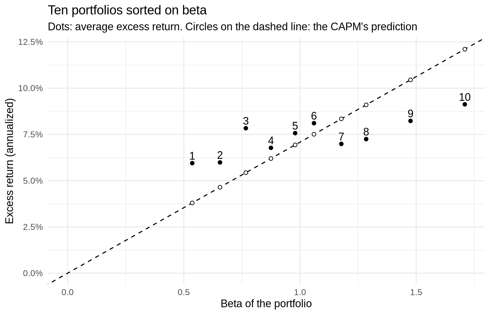
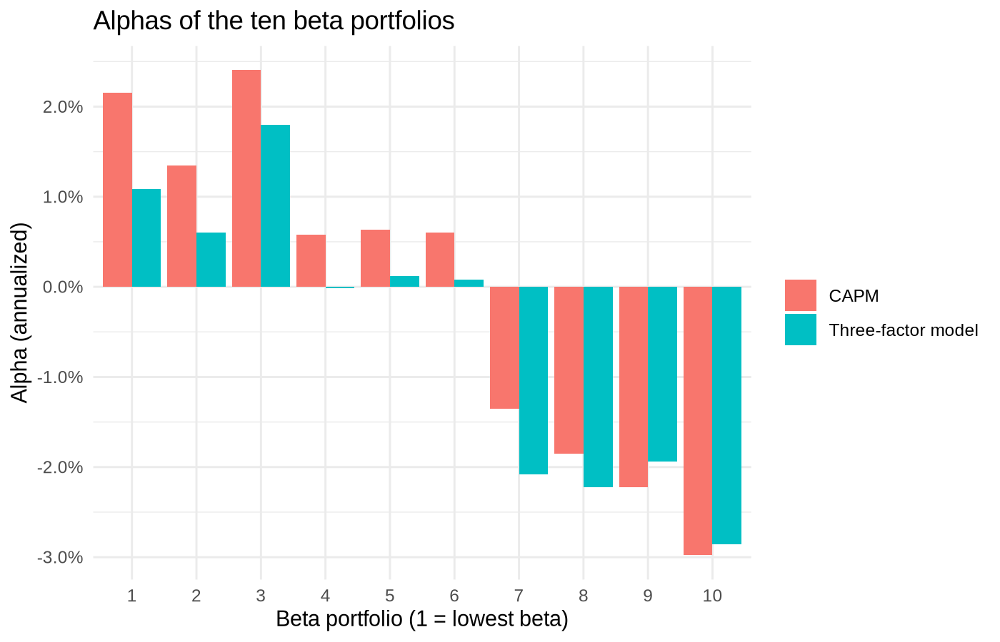

This exercise goes with lectures 6 to 8. You estimate the market beta of one stock, then the betas of all stocks in CRSP, sort the stocks into ten portfolios on their betas, and check whether the CAPM and the Fama-French three-factor model explain the returns of these portfolios. The solutions use the same tidyfinance functions and choices as lecture 7, so your numbers should match the slides.

The website has no CRSP data, so the code below does not run here. The results in the text come from running it, in R and in Python, on the course data, which end in December 2025. R and Python give the same numbers.

## The CAPM beta of one stock {#capm-beta}

**Exercises:**

1. Read the CRSP data from `data/crsp_monthly.parquet` and the Fama-French factors from `data/factors_ff3_monthly.parquet`.
1. Estimate the CAPM regression $R^e_{i,t} = \alpha_i + \beta_i R^e_{m,t} + \varepsilon_{i,t}$ for Apple (`permno` 14593) on all its monthly returns, with `estimate_model()` from tidyfinance. Alternatively, compute the OLS estimate $(X'X)^{-1}X'y$ yourself. What do $\hat\beta$ and $\hat\alpha$ tell you, and what value of $\alpha$ does the CAPM predict?

**Solutions:**

::: {.panel-tabset group="language"}
## R

```{r}
#| label: r-setup
library(tidyverse)
library(tidyfinance)
library(nanoparquet)

# The choices of lecture 7, so that the numbers match the slides
window_length <- 60
min_months <- 48
n_portfolios <- 10
months_per_year <- 12
apple_permno <- 14593

crsp_monthly <- read_parquet("data/crsp_monthly.parquet") |>
  select(permno, date, ret_excess, mktcap_lag, exchange)
factors_ff3_monthly <- read_parquet("data/factors_ff3_monthly.parquet")
```

## Python

```{python}
#| label: py-setup
from datetime import date

import numpy as np
import polars as pl
import tidyfinance as tf
from mizani.formatters import percent_format
from plotnine import (
    aes,
    expand_limits,
    geom_abline,
    geom_col,
    geom_point,
    geom_text,
    ggplot,
    labs,
    position_dodge,
    scale_y_continuous,
)
from scipy.stats import f as f_distribution

# The choices of lecture 7, so that the numbers match the slides
window_length = 60
min_months = 48
n_portfolios = 10
months_per_year = 12
apple_permno = 14593

crsp_monthly = pl.read_parquet("data/crsp_monthly.parquet").select(
    "permno", "date", "ret_excess", "mktcap_lag", "exchange"
)
factors_ff3_monthly = pl.read_parquet("data/factors_ff3_monthly.parquet")
```

:::

::: {.panel-tabset group="language"}
## R

```{r}
#| label: r-apple-beta
apple <- crsp_monthly |>
  filter(permno == apple_permno) |>
  inner_join(factors_ff3_monthly, join_by(date))

apple_capm <- estimate_model(
  apple, "ret_excess ~ mkt_excess", output = c("coefficients", "tstats")
)
apple_capm
```

## Python

```{python}
#| label: py-apple-beta
apple = crsp_monthly.filter(pl.col("permno") == apple_permno).join(
    factors_ff3_monthly, on="date"
)

apple_capm = tf.estimate_model(
    apple, "ret_excess ~ mkt_excess", output=["coefficients", "tstats"]
)
apple_capm
```

:::

Apple has 541 monthly returns, from December 1980 to December 2025. Its beta is 1.35 (t-statistic 12.73): in a month in which the market excess return is one percentage point higher, Apple's excess return is on average 1.35 percentage points higher. The CAPM predicts $\alpha = 0$. Apple's alpha is 1.0% a month, 12.0% a year, with a t-statistic of 2.08. Apple was picked because it is well known, not at random, so one stock that did well is weak evidence against the CAPM.

## Rolling betas for all stocks {#rolling-betas}

Betas change over time. Lecture 7 therefore estimates the beta of every stock in every month from the last five years of monthly returns, a common choice for monthly data.

**Exercises:**

1. For every stock and month, estimate the CAPM regression on the last 60 months, with at least 48 monthly returns in the window. Use `estimate_betas()` from tidyfinance.
1. Store the betas as `data/beta_exercise.parquet`. [Your own test](#own-beta-test) at the end of this page uses them.
1. Check one number: reproduce Apple's beta for December 2025 with a single regression, as in the first section, on the 60 months that end in December 2025. How does it compare with Apple's beta over its whole history?
1. Describe the cross-section of betas: the number of betas and stocks, the first and last month, the mean, the standard deviation, the 5%, 25%, 50%, 75% and 95% quantiles, and the share of negative betas.

**Solutions:**

::: {.panel-tabset group="language"}
## R

```{r}
#| label: r-estimate-betas
betas <- crsp_monthly |>
  inner_join(factors_ff3_monthly, join_by(date)) |>
  estimate_betas("ret_excess ~ mkt_excess", months(window_length), min_obs = min_months)

betas |>
  select(permno, date, beta_mkt_excess) |>
  write_parquet("data/beta_exercise.parquet")
```

## Python

```{python}
#| label: py-estimate-betas
betas = tf.estimate_betas(
    crsp_monthly.join(factors_ff3_monthly, on="date"),
    "ret_excess ~ mkt_excess",
    lookback=f"{window_length}mo",
    min_obs=min_months,
)

betas.select("permno", "date", "beta_mkt_excess").write_parquet(
    "data/beta_exercise.parquet"
)
```

:::

`estimate_betas()` runs the regression on every 60-month window of every stock at once. The window counts calendar months: if a stock has gaps in its history, some windows hold fewer than 60 returns, and windows with fewer than 48 returns get no beta. This takes a few minutes, longer in R than in Python.

::: {.panel-tabset group="language"}
## R

```{r}
#| label: r-check-one-beta
check_month <- as.Date("2025-12-01")

apple_window <- apple |>
  filter(between(date, check_month %m-% months(window_length - 1), check_month))
estimate_model(apple_window, "ret_excess ~ mkt_excess")

betas |>
  filter(permno == apple_permno, date == check_month)
```

## Python

```{python}
#| label: py-check-one-beta
check_month = date(2025, 12, 1)

apple_window = apple.filter(
    pl.col("date").is_between(
        pl.lit(check_month).dt.offset_by(f"-{window_length - 1}mo"), check_month
    )
)
print(tf.estimate_model(apple_window, "ret_excess ~ mkt_excess"))

betas.filter(pl.col("permno") == apple_permno, pl.col("date") == check_month)
```

:::

The window from January 2021 to December 2025 holds 60 returns of Apple, and the single regression gives the same beta as `estimate_betas()`: 1.05. Over its whole history, Apple's beta is 1.35.

::: {.panel-tabset group="language"}
## R

```{r}
#| label: r-summarize-betas
betas |>
  summarize(
    n_betas = n(),
    n_stocks = n_distinct(permno),
    first_month = min(date),
    last_month = max(date),
    mean = mean(beta_mkt_excess),
    sd = sd(beta_mkt_excess),
    q05 = quantile(beta_mkt_excess, 0.05),
    q25 = quantile(beta_mkt_excess, 0.25),
    median = median(beta_mkt_excess),
    q75 = quantile(beta_mkt_excess, 0.75),
    q95 = quantile(beta_mkt_excess, 0.95),
    share_negative = mean(beta_mkt_excess < 0)
  )
```

## Python

```{python}
#| label: py-summarize-betas
beta = pl.col("beta_mkt_excess")

# Linear interpolation, as in R, so that the quantiles match
betas.select(
    n_betas=pl.len(),
    n_stocks=pl.col("permno").n_unique(),
    first_month=pl.col("date").min(),
    last_month=pl.col("date").max(),
    mean=beta.mean(),
    sd=beta.std(),
    q05=beta.quantile(0.05, interpolation="linear"),
    q25=beta.quantile(0.25, interpolation="linear"),
    median=beta.median(),
    q75=beta.quantile(0.75, interpolation="linear"),
    q95=beta.quantile(0.95, interpolation="linear"),
    share_negative=(beta < 0).mean(),
)
```

:::

There are 2,401,783 betas for 18,498 stocks, from December 1963 to December 2025. The first betas come in December 1963 because the data start in January 1960 and a beta needs 48 monthly returns. The betas average 1.11 with a standard deviation of 0.72. Half of them lie between 0.64 and 1.48, the median is 1.04, and 90% lie between 0.13 and 2.33. Only 2.9% are negative.

## Ten portfolios sorted on beta {#beta-sorts}

**Exercises:**

1. Before you sort: what does the CAPM predict for the average excess returns of a portfolio of high-beta stocks and a portfolio of low-beta stocks? What does it predict for their alphas?
1. Each month, sort the stocks into ten portfolios on their beta from the end of the previous month, with `compute_portfolio_returns()` and `breakpoint_options(n_portfolios = 10)`. Use the value-weighted excess returns. Why the previous month's beta and not this month's?
1. Estimate the CAPM regression for each of the ten portfolios. Report the alpha (annualized) with its t-statistic, the beta, the average excess return, and the average excess return the CAPM predicts: the beta times the average market excess return. Plot the average excess returns against the betas, together with the CAPM's prediction.
1. Compute the returns of the high-minus-low portfolio, portfolio 10 minus portfolio 1, with `compute_long_short_returns()`. What are its average excess return, its CAPM alpha and the t-statistic of the alpha?
1. Optional: test all ten alphas at once with the GRS test of lecture 6.

**Solutions:**

The CAPM says $E[R^e_i] = \beta_i\, E[R^e_m]$: the average excess return of a portfolio rises one for one with its beta times the market premium. A portfolio with a beta of 1.5 should earn three times as much as one with a beta of 0.5. Both alphas should be zero, and so should the alpha of a portfolio that is long the high-beta stocks and short the low-beta stocks.

The beta of month $t$ comes from a regression that includes the return of month $t$. Sorting the returns of month $t$ on it would use information that investors do not have when they form the portfolios at the start of the month. The beta from the end of month $t-1$ is known by then.

The betas are in memory if you just estimated them; in a new session, read them from the file.

::: {.panel-tabset group="language"}
## R

```{r}
#| label: r-sort-on-beta
betas <- read_parquet("data/beta_exercise.parquet")

# Sort on last month's beta, which investors know when they form portfolios
beta_lag <- betas |>
  transmute(permno, date = date %m+% months(1), beta_lag = beta_mkt_excess)

beta_portfolios <- crsp_monthly |>
  inner_join(beta_lag, join_by(permno, date)) |>
  compute_portfolio_returns(
    "beta_lag", "univariate",
    breakpoint_options_main = breakpoint_options(n_portfolios = n_portfolios)
  ) |>
  left_join(factors_ff3_monthly, join_by(date))
```

## Python

```{python}
#| label: py-sort-on-beta
betas = pl.read_parquet("data/beta_exercise.parquet")

# Sort on last month's beta, which investors know when they form portfolios
beta_lag = betas.select(
    "permno", pl.col("date").dt.offset_by("1mo"), beta_lag=pl.col("beta_mkt_excess")
)

beta_portfolios = tf.compute_portfolio_returns(
    crsp_monthly.join(beta_lag, on=["permno", "date"]),
    "beta_lag",
    "univariate",
    breakpoint_options_main=tf.breakpoint_options(n_portfolios=n_portfolios),
).join(factors_ff3_monthly, on="date", how="left")
```

:::

`compute_portfolio_returns()` sets the breakpoints each month and returns the value-weighted (`ret_excess_vw`), equal-weighted and capped value-weighted excess returns of each portfolio. The portfolios start in January 1964, one month after the first betas, and end in December 2025: 744 months.

::: {.panel-tabset group="language"}
## R

```{r}
#| label: r-capm-alphas
capm <- beta_portfolios |>
  nest(data = -portfolio) |>
  mutate(
    fit = map(data, \(d) {
      estimate_model(d, "ret_excess_vw ~ mkt_excess", output = c("coefficients", "tstats"))
    }),
    alpha = map_dbl(fit, \(f) f$coefficients$intercept),
    t_alpha = map_dbl(fit, \(f) f$tstats$intercept),
    beta = map_dbl(fit, \(f) f$coefficients$mkt_excess),
    mean = map_dbl(data, \(d) mean(d$ret_excess_vw))
  ) |>
  select(portfolio, alpha, t_alpha, beta, mean) |>
  arrange(portfolio)

market_premium <- beta_portfolios |>
  distinct(date, mkt_excess) |>
  pull(mkt_excess) |>
  mean()

capm_annual <- capm |>
  mutate(
    alpha = alpha * months_per_year,
    mean = mean * months_per_year,
    capm_mean = beta * market_premium * months_per_year
  )
capm_annual
```

## Python

```{python}
#| label: py-capm-alphas
rows = []
for (portfolio,), data in beta_portfolios.group_by("portfolio"):
    fit = tf.estimate_model(
        data, "ret_excess_vw ~ mkt_excess", output=["coefficients", "tstats"]
    )
    rows.append(
        {
            "portfolio": portfolio,
            "alpha": fit["coefficients"]["intercept"][0],
            "t_alpha": fit["tstats"]["intercept"][0],
            "beta": fit["coefficients"]["mkt_excess"][0],
            "mean": data["ret_excess_vw"].mean(),
        }
    )
capm = pl.DataFrame(rows).sort("portfolio")

market_premium = beta_portfolios.unique("date")["mkt_excess"].mean()

capm_annual = capm.with_columns(
    alpha=pl.col("alpha") * months_per_year,
    mean=pl.col("mean") * months_per_year,
    capm_mean=pl.col("beta") * market_premium * months_per_year,
)
capm_annual
```

:::

::: {.panel-tabset group="language"}
## R

```{r}
#| label: r-plot-capm
capm_annual |>
  ggplot(aes(x = beta)) +
  geom_abline(intercept = 0, slope = market_premium * months_per_year, linetype = "dashed") +
  geom_point(aes(y = capm_mean), shape = 21, fill = "white") +
  geom_point(aes(y = mean)) +
  geom_text(aes(y = mean, label = portfolio), nudge_y = 0.004) +
  expand_limits(x = 0, y = 0) +
  scale_y_continuous(labels = scales::percent) +
  labs(
    x = "Beta of the portfolio", y = "Excess return (annualized)",
    title = "Ten portfolios sorted on beta",
    subtitle = "Dots: average excess return. Circles on the dashed line: the CAPM's prediction"
  )
```

## Python

```{python}
#| label: py-plot-capm
(
    ggplot(capm_annual, aes(x="beta"))
    + geom_abline(
        intercept=0, slope=market_premium * months_per_year, linetype="dashed"
    )
    + geom_point(aes(y="capm_mean"), shape="o", fill="white")
    + geom_point(aes(y="mean"))
    + geom_text(aes(y="mean", label="portfolio"), nudge_y=0.004)
    + expand_limits(x=0, y=0)
    + scale_y_continuous(labels=percent_format())
    + labs(
        x="Beta of the portfolio",
        y="Excess return (annualized)",
        title="Ten portfolios sorted on beta",
        subtitle="Dots: average excess return. Circles on the dashed line: the CAPM's prediction",
    )
)
```

:::

{fig-alt="Scatter plot of the ten beta portfolios: the CAPM's predictions lie on a dashed line through the origin from 3.8% at a beta of 0.54 to 12.1% at a beta of 1.71, while the average excess returns only rise from 5.9% to 9.1%, above the line for the six low-beta portfolios and below it for the four high-beta portfolios."}

From 1964 to 2025, the market excess return averaged 7.1% a year. All numbers in the table are annualized (monthly values times 12):

| Portfolio | Beta | Average excess return | CAPM prediction | CAPM alpha | t-statistic of alpha |
|---:|---:|---:|---:|---:|---:|
| 1 (lowest beta) | 0.54 | 5.9% | 3.8% | 2.2% | 1.78 |
| 2 | 0.66 | 6.0% | 4.6% | 1.3% | 1.40 |
| 3 | 0.77 | 7.8% | 5.4% | 2.4% | 2.76 |
| 4 | 0.87 | 6.8% | 6.2% | 0.6% | 0.72 |
| 5 | 0.98 | 7.6% | 6.9% | 0.6% | 0.84 |
| 6 | 1.06 | 8.1% | 7.5% | 0.6% | 0.74 |
| 7 | 1.18 | 7.0% | 8.3% | −1.4% | −1.66 |
| 8 | 1.28 | 7.2% | 9.1% | −1.9% | −1.93 |
| 9 | 1.48 | 8.2% | 10.4% | −2.2% | −1.56 |
| 10 (highest beta) | 1.71 | 9.1% | 12.1% | −3.0% | −1.50 |

The betas of the portfolios run from 0.54 to 1.71, but their average excess returns only from 5.9% to 9.1% a year, where the CAPM predicts 3.8% to 12.1%. The relation between beta and average return is too flat: the six low-beta portfolios have positive alphas, the four high-beta portfolios negative ones. Only portfolio 3 has an alpha with a t-statistic above 2 in absolute value.

::: {.panel-tabset group="language"}
## R

```{r}
#| label: r-high-minus-low
high_minus_low <- beta_portfolios |>
  select(portfolio, date, ret_excess_vw) |>
  compute_long_short_returns() |>
  left_join(factors_ff3_monthly, join_by(date))

mean(high_minus_low$ret_excess_vw) * months_per_year

high_minus_low_capm <- estimate_model(
  high_minus_low, "ret_excess_vw ~ mkt_excess", output = c("coefficients", "tstats")
)
high_minus_low_capm
```

## Python

```{python}
#| label: py-high-minus-low
high_minus_low = tf.compute_long_short_returns(
    beta_portfolios.select("portfolio", "date", "ret_excess_vw")
).join(factors_ff3_monthly, on="date", how="left")

print(high_minus_low["ret_excess_vw"].mean() * months_per_year)

high_minus_low_capm = tf.estimate_model(
    high_minus_low, "ret_excess_vw ~ mkt_excess", output=["coefficients", "tstats"]
)
high_minus_low_capm
```

:::

The high-minus-low portfolio earns 3.2% a year on average, but its beta is 1.17, so the CAPM predicts 8.3%. Its CAPM alpha is −5.1% a year with a t-statistic of −1.87: high-beta stocks earn less than the CAPM predicts and low-beta stocks more, but on its own the alpha is not significant at the 5% level.

The GRS test in lecture 6 has one factor, the market. The function below allows several factors, so you can use it again for the three-factor model: with $K$ factors, the test statistic is $\frac{T-N-K}{N}\,\frac{\hat\alpha'\hat\Sigma^{-1}\hat\alpha}{1 + \hat\mu_f'\hat\Omega^{-1}\hat\mu_f} \sim F(N, T-N-K)$, where $\hat\mu_f$ and $\hat\Omega$ are the mean and the covariance matrix of the factors.

::: {.panel-tabset group="language"}
## R

```{r}
#| label: r-grs-test
compute_grs <- function(returns, factors) {
  n_months <- nrow(returns)
  n_assets <- ncol(returns)
  n_factors <- ncol(factors)

  fit <- lm(returns ~ factors)
  alpha <- coef(fit)[1, ]
  sigma_resid <- crossprod(residuals(fit)) / n_months
  mu_factors <- colMeans(factors)
  sigma_factors <- crossprod(sweep(factors, 2, mu_factors)) / n_months

  grs <- (n_months - n_assets - n_factors) / n_assets *
    as.numeric(t(alpha) %*% solve(sigma_resid, alpha)) /
    (1 + as.numeric(t(mu_factors) %*% solve(sigma_factors, mu_factors)))
  p_value <- 1 - pf(grs, n_assets, n_months - n_assets - n_factors)
  tibble(grs, p_value)
}

portfolios_wide <- beta_portfolios |>
  select(portfolio, date, ret_excess_vw, mkt_excess, smb, hml) |>
  pivot_wider(names_from = portfolio, values_from = ret_excess_vw) |>
  arrange(date)
portfolio_returns <- portfolios_wide |>
  select(-date, -mkt_excess, -smb, -hml) |>
  as.matrix()

compute_grs(portfolio_returns, portfolios_wide |> select(mkt_excess) |> as.matrix())
```

## Python

```{python}
#| label: py-grs-test
def compute_grs(returns, factors):
    n_months, n_assets = returns.shape
    n_factors = factors.shape[1]

    design = np.column_stack([np.ones(n_months), factors])
    coefficients, *_ = np.linalg.lstsq(design, returns, rcond=None)
    alpha = coefficients[0]
    residuals = returns - design @ coefficients
    sigma_resid = residuals.T @ residuals / n_months
    mu_factors = factors.mean(axis=0)
    factors_demeaned = factors - mu_factors
    sigma_factors = factors_demeaned.T @ factors_demeaned / n_months

    grs = (
        (n_months - n_assets - n_factors)
        / n_assets
        * (alpha @ np.linalg.solve(sigma_resid, alpha))
        / (1 + mu_factors @ np.linalg.solve(sigma_factors, mu_factors))
    )
    p_value = 1 - f_distribution.cdf(grs, n_assets, n_months - n_assets - n_factors)
    return {"grs": grs, "p_value": p_value}


portfolios_wide = beta_portfolios.pivot(
    on="portfolio", index=["date", "mkt_excess", "smb", "hml"], values="ret_excess_vw"
).sort("date")
portfolio_returns = portfolios_wide.drop("date", "mkt_excess", "smb", "hml").to_numpy()

compute_grs(portfolio_returns, portfolios_wide.select("mkt_excess").to_numpy())
```

:::

GRS = 1.29 with a p-value of 0.23: the ten portfolios show a clear pattern, but 62 years of ten correlated portfolios are not enough to reject that all ten CAPM alphas are zero.

## The Fama-French three-factor model {#three-factor-model}

Lecture 8 adds two factors to the market: SMB (small minus big) and HML (high minus low book-to-market). Does the three-factor model explain the alphas of the beta portfolios?

**Exercises:**

1. Estimate the three-factor regression $R^e_{i,t} = \alpha_i + \beta_i R^e_{m,t} + s_i\, \text{SMB}_t + h_i\, \text{HML}_t + \varepsilon_{i,t}$ for each of the ten beta portfolios and for the high-minus-low portfolio. The factors are in `factors_ff3_monthly.parquet` (`mkt_excess`, `smb`, `hml`).
1. Compare the three-factor alphas with the CAPM alphas, in a table and a figure. Does the three-factor model explain the beta pattern?
1. Look at the SMB and HML loadings of the low-beta and the high-beta portfolios. What kinds of stocks end up in the high-beta portfolio?
1. Run the GRS test for the three-factor model.

**Solutions:**

::: {.panel-tabset group="language"}
## R

```{r}
#| label: r-three-factor-alphas
three_factor <- beta_portfolios |>
  nest(data = -portfolio) |>
  mutate(
    fit = map(data, \(d) {
      estimate_model(
        d, "ret_excess_vw ~ mkt_excess + smb + hml", output = c("coefficients", "tstats")
      )
    }),
    alpha = map_dbl(fit, \(f) f$coefficients$intercept),
    t_alpha = map_dbl(fit, \(f) f$tstats$intercept),
    beta_market = map_dbl(fit, \(f) f$coefficients$mkt_excess),
    beta_smb = map_dbl(fit, \(f) f$coefficients$smb),
    beta_hml = map_dbl(fit, \(f) f$coefficients$hml)
  ) |>
  select(portfolio, alpha, t_alpha, beta_market, beta_smb, beta_hml) |>
  arrange(portfolio)
three_factor |>
  mutate(alpha = alpha * months_per_year)

estimate_model(
  high_minus_low, "ret_excess_vw ~ mkt_excess + smb + hml", output = c("coefficients", "tstats")
)

compute_grs(
  portfolio_returns, portfolios_wide |> select(mkt_excess, smb, hml) |> as.matrix()
)
```

## Python

```{python}
#| label: py-three-factor-alphas
rows = []
for (portfolio,), data in beta_portfolios.group_by("portfolio"):
    fit = tf.estimate_model(
        data, "ret_excess_vw ~ mkt_excess + smb + hml", output=["coefficients", "tstats"]
    )
    rows.append(
        {
            "portfolio": portfolio,
            "alpha": fit["coefficients"]["intercept"][0],
            "t_alpha": fit["tstats"]["intercept"][0],
            "beta_market": fit["coefficients"]["mkt_excess"][0],
            "beta_smb": fit["coefficients"]["smb"][0],
            "beta_hml": fit["coefficients"]["hml"][0],
        }
    )
three_factor = pl.DataFrame(rows).sort("portfolio")
print(three_factor.with_columns(pl.col("alpha") * months_per_year))

print(
    tf.estimate_model(
        high_minus_low,
        "ret_excess_vw ~ mkt_excess + smb + hml",
        output=["coefficients", "tstats"],
    )
)

compute_grs(
    portfolio_returns, portfolios_wide.select("mkt_excess", "smb", "hml").to_numpy()
)
```

:::

::: {.panel-tabset group="language"}
## R

```{r}
#| label: r-plot-alphas
bind_rows(
  capm |> transmute(portfolio, model = "CAPM", alpha),
  three_factor |> transmute(portfolio, model = "Three-factor model", alpha)
) |>
  ggplot(aes(x = factor(portfolio), y = alpha * months_per_year, fill = model)) +
  geom_col(position = "dodge") +
  scale_y_continuous(labels = scales::percent) +
  labs(
    x = "Beta portfolio (1 = lowest beta)", y = "Alpha (annualized)", fill = NULL,
    title = "Alphas of the ten beta portfolios"
  )
```

## Python

```{python}
#| label: py-plot-alphas
alphas = pl.concat(
    [
        capm.select("portfolio", pl.lit("CAPM").alias("model"), "alpha"),
        three_factor.select(
            "portfolio", pl.lit("Three-factor model").alias("model"), "alpha"
        ),
    ]
).with_columns(alpha=pl.col("alpha") * months_per_year)

(
    ggplot(alphas, aes(x="factor(portfolio)", y="alpha", fill="model"))
    + geom_col(position=position_dodge())
    + scale_y_continuous(labels=percent_format())
    + labs(
        x="Beta portfolio (1 = lowest beta)",
        y="Alpha (annualized)",
        fill="",
        title="Alphas of the ten beta portfolios",
    )
)
```

:::

{fig-alt="Bar chart with two bars per beta portfolio: the CAPM alphas are positive for portfolios 1 to 6, between 0.6% and 2.4% a year, and negative for portfolios 7 to 10, down to -3.0%; the three-factor alphas are smaller for portfolios 1 to 6, about zero for portfolios 4 to 6, and also negative for portfolios 7 to 10, down to -2.9%."}

Alphas in % a year, with their t-statistics, and the loadings of the three-factor regression:

| Portfolio | CAPM alpha | t | Three-factor alpha | t | Market | SMB | HML |
|---:|---:|---:|---:|---:|---:|---:|---:|
| 1 (lowest beta) | 2.2% | 1.78 | 1.1% | 0.93 | 0.60 | −0.12 | 0.25 |
| 2 | 1.3% | 1.40 | 0.6% | 0.69 | 0.73 | −0.23 | 0.19 |
| 3 | 2.4% | 2.76 | 1.8% | 2.24 | 0.83 | −0.21 | 0.16 |
| 4 | 0.6% | 0.72 | 0.0% | −0.02 | 0.92 | −0.14 | 0.15 |
| 5 | 0.6% | 0.84 | 0.1% | 0.16 | 1.01 | −0.09 | 0.13 |
| 6 | 0.6% | 0.74 | 0.1% | 0.10 | 1.09 | −0.07 | 0.13 |
| 7 | −1.4% | −1.66 | −2.1% | −2.63 | 1.19 | 0.06 | 0.16 |
| 8 | −1.9% | −1.93 | −2.2% | −2.35 | 1.26 | 0.15 | 0.07 |
| 9 | −2.2% | −1.56 | −1.9% | −1.48 | 1.38 | 0.42 | −0.10 |
| 10 (highest beta) | −3.0% | −1.50 | −2.9% | −1.70 | 1.53 | 0.82 | −0.11 |
| High minus low | −5.1% | −1.87 | −3.9% | −1.63 | 0.94 | 0.94 | −0.36 |

The three-factor model does not explain the beta pattern. Its alphas still fall with beta, from 1.1% a year for the lowest-beta portfolio to −2.9% for the highest. The alpha of the high-minus-low portfolio shrinks from −5.1% to −3.9% a year (t-statistic −1.63), and portfolios 7 and 8 now have alphas with t-statistics below −2. The GRS test gives 1.55 with a p-value of 0.12, so the three-factor model is not rejected at the 5% level either.

The loadings show which stocks have high betas. The high-beta portfolio loads strongly on SMB (0.82) and slightly negatively on HML (−0.11): high-beta stocks tend to be small growth stocks. The low-beta portfolios load negatively on SMB and positively on HML: they tilt towards large value stocks. The high-minus-low portfolio has an SMB loading of 0.94 (t-statistic 13.67) and an HML loading of −0.36 (t-statistic −5.30). Frazzini and Pedersen (2014), cited in lecture 8, turn this pattern into a factor of its own: betting against beta.

## Your own test: high-beta minus low-beta {#own-beta-test}

**Hypothesis:** high-beta stocks earn lower CAPM alphas than low-beta stocks.

All of you test this hypothesis with the same data: `crsp_monthly`, `factors_ff3_monthly` and your betas from this page. Estimate the CAPM alpha of a portfolio that is long high-beta stocks and short low-beta stocks. Every other choice is yours: the number of portfolios and their breakpoints, equal or value weights, which stocks you keep, the sample period, and the standard errors. Write each choice down.

**Submit by Wednesday 17 March:** your alpha and its standard error, both in % per year, and your choices: [submission form](https://eumel.tail81c88a.ts.net:10000/survey?id=aef27-ex05-beta-sorts). The lecture on reproducibility and non-standard errors shows how far your estimates spread compared with your standard errors.
