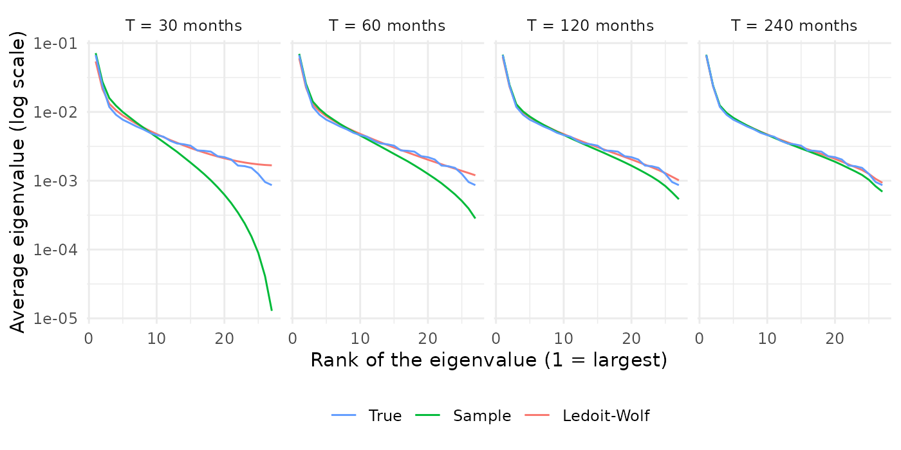
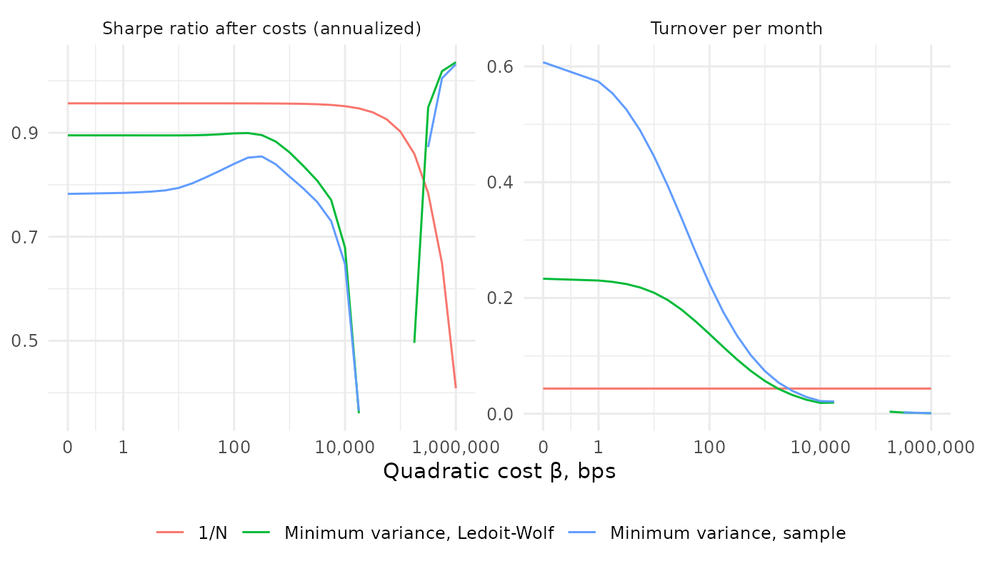
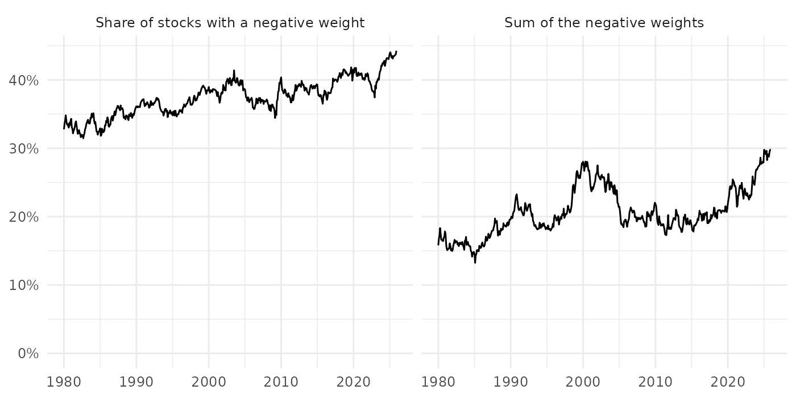

This exercise goes with [lecture 4](../slides/aef-04-shrinkage-for-portfolio-choice.pdf) and [lecture 5](../slides/aef-05-transaction-costs-and-parametric-portfolio-policies.pdf). You study in simulations how Ledoit-Wolf shrinkage changes the estimated covariance matrix and the minimum-variance portfolio, backtest portfolios that take quadratic transaction costs into account, and estimate parametric portfolio policies. The first two sections use the monthly excess returns of today's Dow Jones stocks from [exercise 2](mean_variance.qmd#estimated-portfolios-true-outcomes), January 2000 to December 2025; the code repeats the data preparation of exercise 2, so this page works on its own. The last section uses `crsp_monthly.parquet` from Absalon, as lecture 5 does.

## Shrinking covariance matrices in simulations {#ledoit-wolf-simulations}

Lecture 4 shrinks the sample covariance matrix $\hat\Sigma$ toward the target $F = mI$, with $m$ the average sample variance: $\hat\Sigma_\text{LW} = \hat\delta F + (1 - \hat\delta)\hat\Sigma$, with the shrinkage intensity $\hat\delta$ of Ledoit and Wolf (2004a). In a simulation, the true covariance matrix is known, so we can see what shrinkage does to the estimated covariance matrix and to the minimum-variance portfolio.

**Exercises:**

1. Write a function that returns $\hat\Sigma_\text{LW}$ and $\hat\delta$ for a $T \times N$ matrix of returns. Apply it to the last 60 months of the Dow Jones excess returns, January 2021 to December 2025, and compare $\hat\delta$ with lecture 4. In Python, compare your function with `LedoitWolf()` from scikit-learn. How does shrinkage change the smallest and the largest eigenvalue of the covariance matrix?
2. Simulate $T = 100$ months of independent standard normal returns of $N$ = 10, 30, 50, 70, 90, 100 and 150 assets, 100 samples for each $N$. The true covariance matrix is the identity matrix, so the true minimum-variance portfolio is $1/N$. In each sample, compute the minimum-variance portfolio from $\hat\Sigma$ (if $\hat\Sigma$ has an inverse) and from $\hat\Sigma_\text{LW}$, and the true variance of the portfolio relative to the true variance of $1/N$, $\omega'I\omega / (1/N) = N\omega'\omega$. What happens as $N$ approaches $T$? Why does Ledoit-Wolf do so well in this simulation?
3. Use the Dow Jones stocks as the truth, as in exercise 2: their full-sample mean $\mu_0$ and covariance matrix $\Sigma_0$. Draw 1,000 samples of $T$ = 30, 60, 120 and 240 months from $N(\mu_0, \Sigma_0)$ and estimate $\hat\Sigma$ and $\hat\Sigma_\text{LW}$ in each sample. Plot the average eigenvalues of $\hat\Sigma$ and $\hat\Sigma_\text{LW}$ together with the eigenvalues of $\Sigma_0$.
4. For the same samples, compute the true annualized volatility $\sqrt{12\,\hat\omega'\Sigma_0\hat\omega}$ of the minimum-variance portfolios from $\hat\Sigma$ and from $\hat\Sigma_\text{LW}$, and compare them with the true minimum-variance portfolio and with $1/N$. For which sample length does shrinkage help most?

**Solutions:**

The solutions on this page use the following packages. The constants of this section are the sample period, the length of the estimation window of lecture 4, and the sizes of the two simulations.

::: {.panel-tabset group="language"}
## R

```{r}
#| label: r-setup-shrinkage
library(tidyverse)
library(tidyfinance)
library(nanoparquet)
library(quadprog)

theme_set(theme_minimal())

start_date <- "2000-01-01"
end_date <- "2025-12-31"

months_per_year <- 12
window_length <- 60

iid_sample_length <- 100
iid_asset_counts <- c(10, 30, 50, 70, 90, 100, 150)
iid_samples <- 100

sample_lengths <- c(30, 60, 120, 240)
n_samples <- 1000
```

## Python

```{python}
#| label: py-setup-shrinkage
from datetime import date

import numpy as np
import polars as pl
import tidyfinance as tf
from mizani.formatters import percent_format
from plotnine import (
    aes,
    facet_wrap,
    geom_boxplot,
    geom_hline,
    geom_line,
    ggplot,
    labs,
    scale_color_discrete,
    scale_x_date,
    scale_x_log10,
    scale_y_continuous,
    scale_y_log10,
    theme,
    theme_minimal,
    theme_set,
)
from scipy.optimize import minimize
from sklearn.covariance import LedoitWolf

theme_set(theme_minimal())

start_date = "2000-01-01"
end_date = "2025-12-31"

months_per_year = 12
window_length = 60

iid_sample_length = 100
iid_asset_counts = [10, 30, 50, 70, 90, 100, 150]
iid_samples = 100

sample_lengths = [30, 60, 120, 240]
n_samples = 1000
```
:::

The data are those of exercise 2: today's Dow Jones stocks with a return in every month of the sample, 27 stocks and 311 months from February 2000 to December 2025. The excess returns go into a matrix with one row per month and one column per stock.

::: {.panel-tabset group="language"}
## R

```{r}
#| label: r-excess-returns-shrinkage
symbols <- download_data(
  domain = "Index Constituents",
  index = "Dow Jones Industrial Average"
)

prices_daily <- download_data(
  domain = "Stock Prices",
  symbols = symbols$symbol,
  start_date = start_date,
  end_date = end_date
)

returns_monthly <- prices_daily |>
  arrange(symbol, date) |>
  mutate(date = floor_date(date, "month")) |>
  summarize(price = last(adjusted_close), .by = c(symbol, date)) |>
  mutate(ret = price / lag(price) - 1, .by = symbol) |>
  drop_na(ret) |>
  mutate(months = n(), .by = symbol) |>
  filter(months == max(months)) |>
  select(symbol, date, ret)

risk_free <- read_parquet("data/factors_ff3_monthly.parquet") |>
  select(date, risk_free)

excess_wide <- returns_monthly |>
  left_join(risk_free, join_by(date)) |>
  mutate(ret_excess = ret - risk_free) |>
  pivot_wider(id_cols = date, names_from = symbol, values_from = ret_excess) |>
  arrange(date)
excess_matrix <- excess_wide |>
  select(-date) |>
  as.matrix()
n_months <- nrow(excess_matrix)
n_stocks <- ncol(excess_matrix)
```

## Python

```{python}
#| label: py-excess-returns-shrinkage
symbols = tf.download_data(
    domain="Index Constituents",
    index="Dow Jones Industrial Average",
)

prices_daily = tf.download_data(
    domain="Stock Prices",
    symbols=symbols["symbol"].to_list(),
    start_date=start_date,
    end_date=end_date,
)

returns_monthly = (
    prices_daily.sort("symbol", "date")
    .with_columns(date=pl.col("date").dt.truncate("1mo"))
    .group_by("symbol", "date", maintain_order=True)
    .agg(price=pl.col("adjusted_close").last())
    .with_columns(ret=pl.col("price").pct_change().over("symbol"))
    .drop_nulls("ret")
    .with_columns(months=pl.len().over("symbol"))
    .filter(pl.col("months") == pl.col("months").max())
    .select("symbol", "date", "ret")
)

risk_free = pl.read_parquet("data/factors_ff3_monthly.parquet").select(
    "date", "risk_free"
)

excess_wide = (
    returns_monthly.join(risk_free, on="date", how="left")
    .with_columns(ret_excess=pl.col("ret") - pl.col("risk_free"))
    .pivot(on="symbol", index="date", values="ret_excess")
    .sort("date")
)
excess_matrix = excess_wide.drop("date").to_numpy()
n_months, n_stocks = excess_matrix.shape
```
:::

The function `ledoit_wolf()` is the one of lecture 4. The function demeans the returns $x_t$, computes the sample covariance matrix with $T$ in the denominator, and estimates the shrinkage intensity from how much the products $x_{it}x_{jt}$ scatter around $\hat\sigma_{ij}$. The Python version follows the R code line by line, so that you can check it against scikit-learn.

::: {.panel-tabset group="language"}
## R

```{r}
#| label: r-ledoit-wolf
ledoit_wolf <- function(x) {
  t <- nrow(x)
  x <- sweep(x, 2, colMeans(x))
  sample <- crossprod(x) / t
  target <- mean(diag(sample)) * diag(ncol(x))
  products <- map_dbl(seq_len(t), \(s) sum((tcrossprod(x[s, ]) - sample)^2))
  noise <- sum(products) / t^2
  delta <- min(noise / sum((sample - target)^2), 1)
  list(sigma = delta * target + (1 - delta) * sample, delta = delta)
}

min_variance_weights <- function(sigma) {
  weights <- solve(sigma, rep(1, ncol(sigma)))
  weights / sum(weights)
}

latest_window <- tail(excess_matrix, window_length)
latest_lw <- ledoit_wolf(latest_window)
latest_lw$delta

# The sample covariance matrix inside ledoit_wolf() divides by T, cov() by T - 1
latest_sample <- cov(latest_window) * (window_length - 1) / window_length
tibble(
  matrix = c("Sample", "Ledoit-Wolf"),
  eigenvalues = list(
    eigen(latest_sample, only.values = TRUE)$values,
    eigen(latest_lw$sigma, only.values = TRUE)$values
  )
) |>
  mutate(
    smallest = map_dbl(eigenvalues, min),
    largest = map_dbl(eigenvalues, max),
    ratio = largest / smallest
  ) |>
  select(-eigenvalues)
```

## Python

```{python}
#| label: py-ledoit-wolf
def ledoit_wolf(x):
    t, n = x.shape
    x = x - x.mean(axis=0)
    sample = x.T @ x / t
    target = np.diag(sample).mean() * np.eye(n)
    noise = sum(np.sum((np.outer(row, row) - sample) ** 2) for row in x) / t**2
    delta = min(noise / np.sum((sample - target) ** 2), 1)
    return {"sigma": delta * target + (1 - delta) * sample, "delta": delta}


def min_variance_weights(sigma):
    weights = np.linalg.solve(sigma, np.ones(len(sigma)))
    return weights / weights.sum()


latest_window = excess_matrix[-window_length:]
latest_lw = ledoit_wolf(latest_window)
sklearn_lw = LedoitWolf().fit(latest_window)
print(latest_lw["delta"], sklearn_lw.shrinkage_)
print(np.abs(latest_lw["sigma"] - sklearn_lw.covariance_).max())

# The sample covariance matrix inside ledoit_wolf() divides by T, np.cov() by T - 1
latest_sample = (
    np.cov(latest_window, rowvar=False) * (window_length - 1) / window_length
)
pl.DataFrame(
    [
        {
            "matrix": name,
            "smallest": eigenvalues.min(),
            "largest": eigenvalues.max(),
            "ratio": eigenvalues.max() / eigenvalues.min(),
        }
        for name, eigenvalues in [
            ("Sample", np.linalg.eigvalsh(latest_sample)),
            ("Ledoit-Wolf", np.linalg.eigvalsh(latest_lw["sigma"])),
        ]
    ]
)
```
:::

In the last 60 months, $\hat\delta$ = 0.15, as in lecture 4: Ledoit-Wolf moves 15% of the way from $\hat\Sigma$ to the target. The Python function and `LedoitWolf()` give the same $\hat\delta$ and the same matrix, up to rounding errors of order $10^{-18}$.

Shrinkage toward $mI$ keeps the eigenvectors of $\hat\Sigma$ and moves every eigenvalue toward $m$: an eigenvalue $\hat\lambda$ of $\hat\Sigma$ becomes $\hat\delta m + (1 - \hat\delta)\hat\lambda$, because every vector is an eigenvector of $mI$. Here $m$ is 0.0059, a monthly variance. The smallest eigenvalue rises from 0.00022 to 0.00105, almost five times as much, and the largest falls from 0.059 to 0.051. The ratio of the largest to the smallest eigenvalue falls from 265 to 48. The minimum-variance portfolio puts the most weight on the directions with the smallest eigenvalues (lecture 4), so shrinkage changes the portfolio most where the sample covariance matrix is least reliable.

For the simulation with independent returns, the function `simulate_iid()` draws one sample of $N$ assets and returns $\hat\delta$ and the true variance ratio $N\omega'\omega$ of both minimum-variance portfolios. With $N \geq T$, $\hat\Sigma$ has no inverse: estimating the means uses up one of the $T$ months, so $\hat\Sigma$ has rank $T - 1$ at most.

::: {.panel-tabset group="language"}
## R

```{r}
#| label: r-simulate-iid
simulate_iid <- function(n_assets) {
  returns <- matrix(
    rnorm(iid_sample_length * n_assets),
    nrow = iid_sample_length
  )
  lw <- ledoit_wolf(returns)
  w_sample <- if (n_assets < iid_sample_length) {
    min_variance_weights(cov(returns))
  } else {
    NA
  }
  tibble(
    delta = lw$delta,
    sample = n_assets * sum(w_sample^2),
    ledoit_wolf = n_assets * sum(min_variance_weights(lw$sigma)^2)
  )
}

set.seed(2027)
iid_results <- expand_grid(
  n_assets = iid_asset_counts,
  sample_id = 1:iid_samples
) |>
  mutate(result = map(n_assets, simulate_iid)) |>
  unnest(result)

iid_results |>
  summarize(across(c(delta, sample, ledoit_wolf), mean), .by = n_assets)
```

## Python

```{python}
#| label: py-simulate-iid
rng = np.random.default_rng(2027)


def simulate_iid(n_assets):
    returns = rng.standard_normal((iid_sample_length, n_assets))
    lw = ledoit_wolf(returns)
    w_sample = (
        min_variance_weights(np.cov(returns, rowvar=False))
        if n_assets < iid_sample_length
        else np.full(n_assets, np.nan)
    )
    return {
        "n_assets": n_assets,
        "delta": lw["delta"],
        "sample": n_assets * (w_sample**2).sum(),
        "ledoit_wolf": n_assets * (min_variance_weights(lw["sigma"]) ** 2).sum(),
    }


iid_results = pl.DataFrame(
    [
        simulate_iid(n_assets)
        for n_assets in iid_asset_counts
        for _ in range(iid_samples)
    ]
)

iid_results.group_by("n_assets", maintain_order=True).agg(
    pl.col("delta", "sample", "ledoit_wolf").mean()
)
```
:::

Averages over the 100 samples for each $N$, from the R code:

| $N$ | $\hat\delta$ | Variance ratio, sample | Variance ratio, Ledoit-Wolf |
|---:|---:|---:|---:|
| 10 | 0.94 | 1.10 | 1.00 |
| 30 | 0.96 | 1.41 | 1.00 |
| 50 | 0.97 | 1.99 | 1.00 |
| 70 | 0.98 | 3.30 | 1.00 |
| 90 | 0.98 | 11.3 | 1.00 |
| 100 | 0.98 | none | 1.00 |
| 150 | 0.98 | none | 1.00 |

The minimum-variance portfolio from $\hat\Sigma$ has 10% more variance than $1/N$ with 10 assets, twice as much with 50 assets and 11 times as much with 90 assets. From $N = 100$ on, $\hat\Sigma$ has no inverse and the portfolio does not exist. The Ledoit-Wolf portfolio has at most 0.1% more variance than $1/N$, for every $N$, also for $N > T$. Python draws different random numbers, so its variance ratios for the sample covariance matrix differ slightly: 1.10, 1.42, 1.98, 3.38 and 10.4.

Ledoit-Wolf does so well here because its target is the truth: with independent returns of equal variance, the true covariance matrix is a multiple of the identity matrix. $\hat\delta$ is close to 1, so $\hat\Sigma_\text{LW}$ is close to the target, and the portfolio close to $1/N$. With real returns, the target is wrong; the next two tasks show how much of the gain remains.

For the Dow Jones simulation, the function `simulate_sample()` draws $T$ months from $N(\mu_0, \Sigma_0)$ as in exercise 2 and keeps, for each sample, $\hat\delta$, the eigenvalues of $\hat\Sigma$ and $\hat\Sigma_\text{LW}$, and the true volatility of both minimum-variance portfolios.

::: {.panel-tabset group="language"}
## R

```{r}
#| label: r-simulate-dow-jones
mu_true <- colMeans(excess_matrix)
sigma_true <- cov(excess_matrix)

true_volatility <- function(weights) {
  sqrt(as.numeric(t(weights) %*% sigma_true %*% weights) * months_per_year)
}

simulate_sample <- function(sample_length) {
  noise <- matrix(rnorm(sample_length * n_stocks), nrow = sample_length)
  means <- matrix(mu_true, nrow = sample_length, ncol = n_stocks, byrow = TRUE)
  draws <- means + noise %*% chol(sigma_true)
  sigma_sample <- cov(draws)
  lw <- ledoit_wolf(draws)
  tibble(
    delta = lw$delta,
    eigenvalues = list(tibble(
      rank = 1:n_stocks,
      sample = eigen(sigma_sample, only.values = TRUE)$values,
      ledoit_wolf = eigen(lw$sigma, only.values = TRUE)$values
    )),
    volatility_sample = true_volatility(min_variance_weights(sigma_sample)),
    volatility_lw = true_volatility(min_variance_weights(lw$sigma))
  )
}

set.seed(2027)
simulated <- expand_grid(
  sample_length = sample_lengths,
  sample_id = 1:n_samples
) |>
  mutate(result = map(sample_length, simulate_sample)) |>
  unnest(result)
```

## Python

```{python}
#| label: py-simulate-dow-jones
mu_true = excess_matrix.mean(axis=0)
sigma_true = np.cov(excess_matrix, rowvar=False)


def true_volatility(weights):
    return np.sqrt(weights @ sigma_true @ weights * months_per_year)


rng = np.random.default_rng(2027)


def simulate_sample(sample_length):
    draws = rng.multivariate_normal(
        mu_true, sigma_true, size=sample_length, method="cholesky"
    )
    sigma_sample = np.cov(draws, rowvar=False)
    lw = ledoit_wolf(draws)
    return {
        "sample_length": sample_length,
        "delta": lw["delta"],
        "rank": list(range(1, n_stocks + 1)),
        "eigenvalues_sample": np.linalg.eigvalsh(sigma_sample)[::-1].tolist(),
        "eigenvalues_lw": np.linalg.eigvalsh(lw["sigma"])[::-1].tolist(),
        "volatility_sample": true_volatility(min_variance_weights(sigma_sample)),
        "volatility_lw": true_volatility(min_variance_weights(lw["sigma"])),
    }


simulated = pl.DataFrame(
    [
        simulate_sample(sample_length)
        for sample_length in sample_lengths
        for _ in range(n_samples)
    ]
)
```
:::

The eigenvalues are averaged by rank over the samples of each length.

::: {.panel-tabset group="language"}
## R

```{r}
#| label: r-plot-eigenvalues
average_eigenvalues <- simulated |>
  select(sample_length, eigenvalues) |>
  unnest(eigenvalues) |>
  summarize(
    across(c(sample, ledoit_wolf), mean),
    .by = c(sample_length, rank)
  ) |>
  mutate(true = eigen(sigma_true, only.values = TRUE)$values[rank]) |>
  pivot_longer(
    c(true, sample, ledoit_wolf),
    names_to = "matrix",
    values_to = "eigenvalue"
  )

average_eigenvalues |>
  filter(rank == n_stocks) |>
  pivot_wider(names_from = matrix, values_from = eigenvalue)

average_eigenvalues |>
  ggplot(aes(x = rank, y = eigenvalue, color = matrix)) +
  geom_line() +
  facet_wrap(
    ~sample_length,
    nrow = 1,
    labeller = as_labeller(\(x) paste("T =", x, "months"))
  ) +
  scale_y_log10() +
  scale_color_discrete(
    breaks = c("true", "sample", "ledoit_wolf"),
    labels = c("True", "Sample", "Ledoit-Wolf")
  ) +
  labs(
    x = "Rank of the eigenvalue (1 = largest)",
    y = "Average eigenvalue (log scale)",
    color = NULL
  ) +
  theme(legend.position = "bottom")
```

## Python

```{python}
#| label: py-plot-eigenvalues
true_eigenvalues = pl.DataFrame(
    {
        "rank": range(1, n_stocks + 1),
        "true": np.linalg.eigvalsh(sigma_true)[::-1],
    }
)

average_eigenvalues = (
    simulated.explode("rank", "eigenvalues_sample", "eigenvalues_lw")
    .group_by("sample_length", "rank")
    .agg(
        sample=pl.col("eigenvalues_sample").mean(),
        ledoit_wolf=pl.col("eigenvalues_lw").mean(),
    )
    .join(true_eigenvalues, on="rank")
    .unpivot(
        ["true", "sample", "ledoit_wolf"],
        index=["sample_length", "rank"],
        variable_name="matrix",
        value_name="eigenvalue",
    )
)

print(
    average_eigenvalues.filter(pl.col("rank") == n_stocks)
    .pivot(on="matrix", index="sample_length", values="eigenvalue")
    .sort("sample_length")
)

(
    ggplot(average_eigenvalues, aes(x="rank", y="eigenvalue", color="matrix"))
    + geom_line()
    + facet_wrap("sample_length", nrow=1, labeller=lambda x: f"T = {x} months")
    + scale_y_log10()
    + scale_color_discrete(
        breaks=["true", "sample", "ledoit_wolf"],
        labels=["True", "Sample", "Ledoit-Wolf"],
    )
    + labs(
        x="Rank of the eigenvalue (1 = largest)",
        y="Average eigenvalue (log scale)",
        color="",
    )
    + theme(legend_position="bottom")
)
```
:::

{fig-alt="Four panels, for samples of 30, 60, 120 and 240 months, with the eigenvalues of the true covariance matrix, and the average eigenvalues of the sample covariance matrix and of the Ledoit-Wolf estimate, on a log scale against their rank."}

The sample eigenvalues are too spread out, as in lecture 4: the largest are too large and the smallest too small. The smallest true eigenvalue is 0.00086. With 30 months, the smallest sample eigenvalue is 0.000013 on average, about 70 times too small; with 60 months 0.00028, with 120 months 0.00054 and with 240 months 0.00069. Ledoit-Wolf pulls all eigenvalues toward their average: its smallest eigenvalue is 0.0017 with 30 months, about twice the true one, and 0.0012, 0.0010 and 0.00093 for the longer samples. Ledoit-Wolf thus errs on the other side, but by a factor of 2 instead of 70, and the more months, the smaller $\hat\delta$ and the closer both estimates come to the truth. Python draws different random numbers, so its averages differ slightly, for example 0.000012 and 0.0017 for 30 months.

For task 4, the true volatilities of the two estimated minimum-variance portfolios are compared with those of the true minimum-variance portfolio (solid line) and of $1/N$ (dashed line).

::: {.panel-tabset group="language"}
## R

```{r}
#| label: r-plot-volatility
true_mvp_volatility <- true_volatility(min_variance_weights(sigma_true))
naive_volatility <- true_volatility(rep(1 / n_stocks, n_stocks))
c(true_mvp_volatility, naive_volatility)

simulated |>
  summarize(
    delta = mean(delta),
    sample = median(volatility_sample),
    ledoit_wolf = median(volatility_lw),
    share_lw_lower = mean(volatility_lw < volatility_sample),
    .by = sample_length
  )

simulated |>
  pivot_longer(
    c(volatility_sample, volatility_lw),
    names_to = "matrix",
    values_to = "volatility"
  ) |>
  mutate(
    matrix = fct_inorder(if_else(
      matrix == "volatility_sample",
      "Sample",
      "Ledoit-Wolf"
    ))
  ) |>
  ggplot(aes(x = matrix, y = volatility)) +
  geom_boxplot(outliers = FALSE) +
  geom_hline(yintercept = true_mvp_volatility) +
  geom_hline(yintercept = naive_volatility, linetype = "dashed") +
  facet_wrap(
    ~sample_length,
    nrow = 1,
    scales = "free_y",
    labeller = as_labeller(\(x) paste("T =", x, "months"))
  ) +
  labs(x = NULL, y = "True volatility (annualized)")
```

## Python

```{python}
#| label: py-plot-volatility
true_mvp_volatility = true_volatility(min_variance_weights(sigma_true))
naive_volatility = true_volatility(np.ones(n_stocks) / n_stocks)
print(true_mvp_volatility, naive_volatility)

print(
    simulated.group_by("sample_length", maintain_order=True).agg(
        delta=pl.col("delta").mean(),
        sample=pl.col("volatility_sample").median(),
        ledoit_wolf=pl.col("volatility_lw").median(),
        share_lw_lower=(pl.col("volatility_lw") < pl.col("volatility_sample")).mean(),
    )
)

(
    ggplot(
        simulated.unpivot(
            ["volatility_sample", "volatility_lw"],
            index="sample_length",
            variable_name="matrix",
            value_name="volatility",
        ).with_columns(
            pl.col("matrix").replace_strict(
                {"volatility_sample": "Sample", "volatility_lw": "Ledoit-Wolf"},
                return_dtype=pl.Enum(["Sample", "Ledoit-Wolf"]),
            )
        ),
        aes(x="matrix", y="volatility"),
    )
    + geom_boxplot(outlier_shape="")
    + geom_hline(yintercept=true_mvp_volatility)
    + geom_hline(yintercept=naive_volatility, linetype="dashed")
    + facet_wrap(
        "sample_length",
        nrow=1,
        scales="free_y",
        labeller=lambda x: f"T = {x} months",
    )
    + labs(x="", y="True volatility (annualized)")
)
```
:::

{fig-alt="Four panels, for samples of 30, 60, 120 and 240 months, with box plots of the true annualized volatility of the estimated minimum-variance portfolios from the sample covariance matrix and from Ledoit-Wolf, and horizontal lines for the true minimum-variance portfolio and for 1/N."}

The true minimum-variance portfolio has a volatility of 11.2% a year, $1/N$ one of 15.7%. Averages of $\hat\delta$ and medians of the true volatilities over the 1,000 samples of each length, from the R code:

| $T$ | $\hat\delta$ | Sample | Ledoit-Wolf | Samples in which Ledoit-Wolf has the lower volatility |
|---:|---:|---:|---:|---:|
| 30 | 0.25 | 32.7% | 13.2% | 100% |
| 60 | 0.14 | 14.9% | 12.7% | 100% |
| 120 | 0.08 | 12.6% | 12.2% | 100% |
| 240 | 0.04 | 11.8% | 11.7% | 99.3% |

Shrinkage helps most for short samples. With 30 months, the minimum-variance portfolio from $\hat\Sigma$ is twice as volatile as $1/N$, while the Ledoit-Wolf portfolio comes close to the true minimum-variance portfolio. With 60 months, the window of the backtests in lectures 3 to 5, Ledoit-Wolf lowers the median volatility from 14.9% to 12.7%, and it does better in every sample. With 240 months, both estimates are close to the truth, and $\hat\delta$ is small. The simulation is kinder to the estimates than a backtest, because the returns are normal and $\mu_0$ and $\Sigma_0$ never change. Python draws different random numbers: its medians are 33.1% and 13.3% for 30 months, 14.9% and 12.7% for 60 months, 12.6% and 12.2% for 120 months, and 11.9% and 11.8% for 240 months, where Ledoit-Wolf does better in 99.7% of the samples.

## Backtesting cost-aware portfolios {#backtesting-transaction-costs}

Lecture 5 charges quadratic transaction costs: rebalancing from the drifted weights $\omega_{t^+}$ to $\omega_{t+1}$ costs $\frac{\beta}{2}\sum_i (\omega_{i,t+1} - \omega_{i,t^+})^2$ of wealth, where $\beta$ is the actual trading cost in the market. A cost-aware investor solves
$$
\omega_{t+1} = \arg\max_{\iota'\omega = 1} \ \omega'\mu - \frac{\beta}{2}(\omega - \omega_{t^+})'(\omega - \omega_{t^+}) - \frac{\gamma}{2}\omega'\Sigma\omega,
$$
which is the mean-variance problem with $\Sigma^* = \Sigma + \frac{\beta}{\gamma}I$ and $\mu^* = \mu + \beta\,\omega_{t^+}$ (Hautsch and Voigt, [2019](https://www.sciencedirect.com/science/article/pii/S0304407619300831)). The investor plans with the same $\beta$ that the backtest charges. Values of $\beta$ are given in basis points (bps): $\beta$ = 100 bps is $\beta = 0.01$.

**Exercises:**

1. Write a function that computes the cost-aware weights for given $\mu$, $\Sigma$, $\omega_{t^+}$, $\beta$ and $\gamma$. Check it with a numerical optimizer, for the estimates $\hat\mu$ and $\hat\Sigma$ from the last 60 months, $\gamma = 4$, $\beta$ = 100 bps and $\omega_{t^+} = 1/N$. How much does the investor trade for $\beta = 0$, for $\beta$ = 100 bps and for $\beta$ = 1,000,000 bps?
2. Lecture 5 says that costs act as shrinkage. Show that for $\mu = 0$ and $\omega_{t^+} = 1/N$, the cost-aware portfolio is the minimum-variance portfolio of $\hat\Sigma + \frac{\beta}{\gamma}I$. For the last 60 months, find the $\beta$ at which it equals the Ledoit-Wolf minimum-variance portfolio of the first section. Compute this $\beta$ for every 60-month window from February 2005 on.
3. Backtest three strategies on the Dow Jones stocks as in lecture 5: every month from February 2005 to December 2025, estimate $\hat\Sigma$ from the last 60 months, start from the drifted weights $\omega_{t^+}$ and choose the cost-aware weights with $\mu = 0$ and $\gamma = 4$, once with $\hat\Sigma$ and once with $\hat\Sigma_\text{LW}$. Both start with $1/N$. The third strategy is $1/N$, rebalanced every month. Use the values of $\beta$ of lecture 5, 0 and 1 to 1,000,000 bps, and charge every strategy $\frac{\beta}{2}\sum_i \Delta\omega_i^2$. Plot the annualized Sharpe ratio after costs and the turnover against $\beta$. Does Ledoit-Wolf still pay once trading costs?
4. Add the estimated expected returns: backtest the cost-aware mean-variance portfolio with $\hat\mu$, $\hat\Sigma_\text{LW}$ and $\gamma = 4$. A strategy whose total return in a month is $-100\%$ or worse is bankrupt. For which values of $\beta$ does the strategy survive, and how does it compare with the minimum-variance portfolios?

**Solutions:**

The constants of this section are the risk aversion, the values of $\beta$ of lecture 5, and the $\beta$ for the check in task 1.

::: {.panel-tabset group="language"}
## R

```{r}
#| label: r-setup-costs
gamma <- 4
betas <- c(0, 10^seq(-4, 2, by = 0.25))
beta_check <- 0.01
```

## Python

```{python}
#| label: py-setup-costs
gamma = 4
betas = np.concatenate([[0], 10 ** np.arange(-4, 2.01, 0.25)])
beta_check = 0.01
```
:::

The function `cost_aware_weights()` generalizes the function of lecture 5 to any $\mu$: it computes the efficient portfolio for $\mu^*$ and $\Sigma^*$, the minimum-variance portfolio plus $\frac{1}{\gamma}A\mu^*$ with $A = \Sigma^{*-1} - \Sigma^{*-1}\iota\iota'\Sigma^{*-1} / \iota'\Sigma^{*-1}\iota$. The numerical check solves the same problem as a quadratic program: minimize $\frac{1}{2}\omega'(\gamma\hat\Sigma + \beta I)\omega - (\hat\mu + \beta\omega_{t^+})'\omega$ subject to $\iota'\omega = 1$.

::: {.panel-tabset group="language"}
## R

```{r}
#| label: r-cost-aware-weights
cost_aware_weights <- function(mu, sigma, w_plus, beta, gamma) {
  sigma_star <- sigma + beta / gamma * diag(ncol(sigma))
  mu_star <- mu + beta * w_plus
  sigma_inv <- solve(sigma_star)
  w_mvp <- rowSums(sigma_inv) / sum(sigma_inv)
  a <- sigma_inv - tcrossprod(rowSums(sigma_inv)) / sum(sigma_inv)
  as.vector(w_mvp + a %*% mu_star / gamma)
}

mu_hat <- colMeans(latest_window)
sigma_hat <- cov(latest_window)
w_naive <- rep(1 / n_stocks, n_stocks)

w_check <- cost_aware_weights(mu_hat, sigma_hat, w_naive, beta_check, gamma)
w_numerical <- solve.QP(
  Dmat = gamma * sigma_hat + beta_check * diag(n_stocks),
  dvec = mu_hat + beta_check * w_naive,
  Amat = matrix(1, nrow = n_stocks),
  bvec = 1,
  meq = 1
)$solution
max(abs(w_check - w_numerical))

tibble(beta = c(0, beta_check, max(betas))) |>
  mutate(
    turnover = map_dbl(beta, \(b) {
      w <- cost_aware_weights(mu_hat, sigma_hat, w_naive, b, gamma)
      sum(abs(w - w_naive))
    })
  )
```

## Python

```{python}
#| label: py-cost-aware-weights
def cost_aware_weights(mu, sigma, w_plus, beta, gamma):
    sigma_star = sigma + beta / gamma * np.eye(len(sigma))
    mu_star = mu + beta * w_plus
    sigma_inv = np.linalg.inv(sigma_star)
    row_sums = sigma_inv.sum(axis=1)
    w_mvp = row_sums / sigma_inv.sum()
    a = sigma_inv - np.outer(row_sums, row_sums) / sigma_inv.sum()
    return w_mvp + a @ mu_star / gamma


mu_hat = latest_window.mean(axis=0)
sigma_hat = np.cov(latest_window, rowvar=False)
w_naive = np.ones(n_stocks) / n_stocks

w_check = cost_aware_weights(mu_hat, sigma_hat, w_naive, beta_check, gamma)
d = gamma * sigma_hat + beta_check * np.eye(n_stocks)
c = mu_hat + beta_check * w_naive
w_numerical = minimize(
    lambda w: w @ d @ w / 2 - c @ w,
    x0=w_naive,
    jac=lambda w: d @ w - c,
    constraints={"type": "eq", "fun": lambda w: w.sum() - 1},
    method="SLSQP",
    options={"ftol": 1e-15, "maxiter": 1000},
).x
print(np.abs(w_check - w_numerical).max())

pl.DataFrame(
    [
        {
            "beta": b,
            "turnover": np.abs(
                cost_aware_weights(mu_hat, sigma_hat, w_naive, b, gamma) - w_naive
            ).sum(),
        }
        for b in [0, beta_check, betas.max()]
    ]
)
```
:::

The closed form and the quadratic program agree: the largest difference between the weights is of order $10^{-16}$ with `solve.QP()` and $4 \cdot 10^{-7}$, the tolerance of the optimizer, with `minimize()`. Without costs, the investor moves from $1/N$ to the mean-variance portfolio of $\hat\mu$ and $\hat\Sigma$ in one trade with a turnover of 2,854% of wealth, because the estimated expected returns of 60 months call for large long and short positions (lecture 3). With $\beta$ = 100 bps, the turnover falls to 813%; with $\beta$ = 1,000,000 bps, to 0.2%, and the investor keeps almost exactly $1/N$.

For task 2: with $\mu = 0$, the cost-aware weights are the minimum-variance portfolio of $\Sigma^*$ plus $\frac{\beta}{\gamma}A\,\omega_{t^+}$. For $\omega_{t^+} = 1/N$, the second term is zero, because $A\iota = \Sigma^{*-1}\iota - \Sigma^{*-1}\iota\,\frac{\iota'\Sigma^{*-1}\iota}{\iota'\Sigma^{*-1}\iota} = 0$. What remains is the minimum-variance portfolio of $\hat\Sigma + \frac{\beta}{\gamma}I$. The minimum-variance portfolio does not change if we multiply the covariance matrix by a positive number, and
$$
\hat\Sigma_\text{LW} = \hat\delta mI + (1 - \hat\delta)\hat\Sigma = (1 - \hat\delta)\left(\hat\Sigma + \frac{\hat\delta m}{1 - \hat\delta}I\right),
$$
so both portfolios are the same for $\beta = \gamma\hat\delta m / (1 - \hat\delta)$. Here $\hat\Sigma$ is the sample covariance matrix inside `ledoit_wolf()`, with $T$ in the denominator, and $m$ the average of its diagonal, which is also the average of the diagonal of $\hat\Sigma_\text{LW}$. The list `estimates` keeps the estimates of every window of the backtest, so that the backtests below can reuse them.

::: {.panel-tabset group="language"}
## R

```{r}
#| label: r-costs-as-shrinkage
beta_lw <- function(lw) {
  gamma * lw$delta * mean(diag(lw$sigma)) / (1 - lw$delta)
}

beta_lw(latest_lw)
max(abs(
  cost_aware_weights(0, latest_sample, w_naive, beta_lw(latest_lw), gamma) -
    min_variance_weights(latest_lw$sigma)
))

backtest_months <- (window_length + 1):n_months
estimates <- map(backtest_months, \(t) {
  window <- excess_matrix[(t - window_length):(t - 1), ]
  lw <- ledoit_wolf(window)
  list(
    mu = colMeans(window),
    sigma = cov(window),
    sigma_lw = lw$sigma,
    beta_lw = beta_lw(lw)
  )
})

summary(map_dbl(estimates, "beta_lw") * 1e4)
```

## Python

```{python}
#| label: py-costs-as-shrinkage
def beta_lw(lw):
    return gamma * lw["delta"] * np.diag(lw["sigma"]).mean() / (1 - lw["delta"])


print(beta_lw(latest_lw))
print(
    np.abs(
        cost_aware_weights(0, latest_sample, w_naive, beta_lw(latest_lw), gamma)
        - min_variance_weights(latest_lw["sigma"])
    ).max()
)

backtest_months = range(window_length, n_months)
estimates = []
for t in backtest_months:
    window = excess_matrix[t - window_length : t]
    lw = ledoit_wolf(window)
    estimates.append(
        {
            "mu": window.mean(axis=0),
            "sigma": np.cov(window, rowvar=False),
            "sigma_lw": lw["sigma"],
            "beta_lw": beta_lw(lw),
        }
    )

pl.Series([e["beta_lw"] * 1e4 for e in estimates]).describe()
```
:::

For the last 60 months, the cost-aware portfolio equals the Ledoit-Wolf minimum-variance portfolio at $\beta$ = 41 bps: the weights differ by less than $10^{-15}$. In the 251 windows of the backtest, from February 2005 to December 2025, this $\beta$ lies between 25 and 95 bps, with a median of 41 bps. The equivalence only holds for a trade that starts from $1/N$. In the backtest, $\omega_{t^+}$ is last month's portfolio after the drift, and the term $\frac{\beta}{\gamma}A\,\omega_{t^+}$ also pulls the new weights toward the current portfolio, which Ledoit-Wolf does not do. With $\mu = 0$, $\beta$ and $\gamma$ only enter the weights through $\beta/\gamma$: an investor with twice the risk aversion trades as if the costs were half as large.

The backtest needs the returns themselves, not only the excess returns, for the drift of the weights. The function `backtest_strategy()` runs one strategy for one $\beta$: every month, it drifts last month's weights with last month's returns, chooses the new weights with the function `choose_weights()` of the strategy, and records the excess return, the turnover and the cost. `summarize_backtest()` computes the annualized Sharpe ratio of the excess returns after costs, the turnover per month and the costs per year, and marks a strategy as bankrupt if it loses everything in some month.

::: {.panel-tabset group="language"}
## R

```{r}
#| label: r-backtest-functions
returns_matrix <- returns_monthly |>
  pivot_wider(id_cols = date, names_from = symbol, values_from = ret) |>
  arrange(date) |>
  select(-date) |>
  as.matrix()

backtest_strategy <- function(choose_weights, beta) {
  w <- rep(1 / n_stocks, n_stocks)
  results <- vector("list", length(backtest_months))
  for (k in seq_along(backtest_months)) {
    t <- backtest_months[k]
    drift <- w * (1 + returns_matrix[t - 1, ])
    w_plus <- drift / sum(drift)
    w <- choose_weights(estimates[[k]], w_plus, beta)
    results[[k]] <- tibble(
      date = excess_wide$date[t],
      ret_excess = sum(w * excess_matrix[t, ]),
      turnover = sum(abs(w - w_plus)),
      cost = beta / 2 * sum((w - w_plus)^2)
    )
  }
  bind_rows(results)
}

summarize_backtest <- function(backtest) {
  backtest |>
    left_join(risk_free, join_by(date)) |>
    mutate(ret_net = ret_excess - cost) |>
    summarize(
      bankrupt = any(ret_net + risk_free <= -1),
      sharpe = mean(ret_net) / sd(ret_net) * sqrt(months_per_year),
      turnover = mean(turnover),
      cost = mean(cost) * months_per_year,
      .by = c(strategy, beta)
    ) |>
    mutate(across(c(sharpe, turnover, cost), \(x) if_else(bankrupt, NA, x)))
}
```

## Python

```{python}
#| label: py-backtest-functions
returns_matrix = (
    returns_monthly.pivot(on="symbol", index="date", values="ret")
    .sort("date")
    .drop("date")
    .to_numpy()
)


def backtest_strategy(choose_weights, beta):
    w = np.ones(n_stocks) / n_stocks
    results = []
    for k, t in enumerate(backtest_months):
        drift = w * (1 + returns_matrix[t - 1])
        w_plus = drift / drift.sum()
        w = choose_weights(estimates[k], w_plus, beta)
        results.append(
            {
                "date": excess_wide["date"][t],
                "ret_excess": w @ excess_matrix[t],
                "turnover": np.abs(w - w_plus).sum(),
                "cost": beta / 2 * ((w - w_plus) ** 2).sum(),
            }
        )
    return pl.DataFrame(results)


def summarize_backtest(backtest):
    return (
        backtest.join(risk_free, on="date", how="left")
        .with_columns(ret_net=pl.col("ret_excess") - pl.col("cost"))
        .group_by("strategy", "beta", maintain_order=True)
        .agg(
            bankrupt=(pl.col("ret_net") + pl.col("risk_free") <= -1).any(),
            sharpe=pl.col("ret_net").mean()
            / pl.col("ret_net").std()
            * np.sqrt(months_per_year),
            turnover=pl.col("turnover").mean(),
            cost=pl.col("cost").mean() * months_per_year,
        )
        .with_columns(
            pl.when(~pl.col("bankrupt")).then(pl.col(name)).alias(name)
            for name in ["sharpe", "turnover", "cost"]
        )
    )
```
:::

The three strategies of task 3 differ only in `choose_weights()`.

::: {.panel-tabset group="language"}
## R

```{r}
#| label: r-backtest-minimum-variance
strategies <- list(
  "Minimum variance, sample" = \(estimate, w_plus, beta) {
    cost_aware_weights(0, estimate$sigma, w_plus, beta, gamma)
  },
  "Minimum variance, Ledoit-Wolf" = \(estimate, w_plus, beta) {
    cost_aware_weights(0, estimate$sigma_lw, w_plus, beta, gamma)
  },
  "1/N" = \(estimate, w_plus, beta) rep(1 / n_stocks, n_stocks)
)

backtest <- expand_grid(strategy = names(strategies), beta = betas) |>
  mutate(
    result = map2(strategy, beta, \(s, b) backtest_strategy(strategies[[s]], b))
  ) |>
  unnest(result)

backtest_summary <- summarize_backtest(backtest)

backtest_summary |>
  mutate(beta_bps = beta * 1e4) |>
  print(n = Inf)

# beta = 0 is drawn at 0.1 bps, so that the axis can be logarithmic
backtest_summary |>
  mutate(beta_bps = pmax(beta * 1e4, 0.1)) |>
  pivot_longer(c(sharpe, turnover), names_to = "measure") |>
  ggplot(aes(x = beta_bps, y = value, color = strategy)) +
  geom_line(na.rm = TRUE) +
  facet_wrap(
    ~measure,
    scales = "free_y",
    labeller = as_labeller(c(
      sharpe = "Sharpe ratio after costs (annualized)",
      turnover = "Turnover per month"
    ))
  ) +
  scale_x_log10(
    breaks = c(0.1, 1, 100, 1e4, 1e6),
    labels = c("0", "1", "100", "10,000", "1,000,000")
  ) +
  labs(x = "Quadratic cost β, bps", y = NULL, color = NULL) +
  theme(legend.position = "bottom", plot.margin = margin(5.5, 25, 5.5, 5.5))
```

## Python

```{python}
#| label: py-backtest-minimum-variance
strategies = {
    "Minimum variance, sample": lambda estimate, w_plus, beta: cost_aware_weights(
        0, estimate["sigma"], w_plus, beta, gamma
    ),
    "Minimum variance, Ledoit-Wolf": lambda estimate, w_plus, beta: (
        cost_aware_weights(0, estimate["sigma_lw"], w_plus, beta, gamma)
    ),
    "1/N": lambda estimate, w_plus, beta: np.ones(n_stocks) / n_stocks,
}

backtest = pl.concat(
    [
        backtest_strategy(choose_weights, beta).with_columns(
            strategy=pl.lit(strategy), beta=pl.lit(beta)
        )
        for strategy, choose_weights in strategies.items()
        for beta in betas
    ]
)

backtest_summary = summarize_backtest(backtest)
print(backtest_summary)

(
    ggplot(
        backtest_summary.with_columns(
            beta_bps=(pl.col("beta") * 1e4).clip(lower_bound=0.1)
        ).unpivot(
            ["sharpe", "turnover"],
            index=["strategy", "beta_bps"],
            variable_name="measure",
        ),
        aes(x="beta_bps", y="value", color="strategy"),
    )
    + geom_line()
    + facet_wrap(
        "measure",
        scales="free_y",
        labeller=lambda x: {
            "sharpe": "Sharpe ratio after costs (annualized)",
            "turnover": "Turnover per month",
        }[x],
    )
    + scale_x_log10(
        breaks=[0.1, 1, 100, 1e4, 1e6],
        labels=["0", "1", "100", "10,000", "1,000,000"],
    )
    + labs(x="Quadratic cost β, bps", y="", color="")
    + theme(legend_position="bottom")
)
```
:::

{fig-alt="Two panels against the quadratic cost beta on a log scale from 0 to 1,000,000 bps: the Sharpe ratio after costs and the turnover per month of the cost-aware minimum-variance portfolios with the sample and the Ledoit-Wolf covariance matrix, and of 1/N."}

Selected values of $\beta$, Sharpe ratios after costs and turnover per month, from the R code; Python gives the same numbers:

| $\beta$, bps | Minimum variance, sample | Minimum variance, Ledoit-Wolf | $1/N$ |
|---:|---:|---:|---:|
| 0 | 0.78 (61%) | 0.90 (23%) | 0.96 (4%) |
| 100 | 0.84 (22%) | 0.90 (14%) | 0.96 (4%) |
| 316 | 0.85 (13%) | 0.90 (9%) | 0.96 (4%) |
| 10,000 | 0.65 (2%) | 0.68 (2%) | 0.95 (4%) |
| 100,000 | bankrupt | bankrupt | 0.90 (4%) |
| 1,000,000 | 1.03 (0.1%) | 1.04 (0.1%) | 0.41 (4%) |

The sample covariance matrix reproduces lecture 5: costs lift the Sharpe ratio from 0.78 to 0.85 at $\beta$ = 316 bps, and the turnover falls from 61% to 13% a month. Ledoit-Wolf starts at 0.90, the number of lecture 4, and beats the sample covariance matrix at every $\beta$ up to 10,000 bps. So Ledoit-Wolf still pays, but the costs add little on top of it: up to $\beta$ = 316 bps, its Sharpe ratio stays between 0.895 and 0.899, while its turnover falls from 23% to 9% a month. Ledoit-Wolf has already done most of the shrinkage that the costs do to $\hat\Sigma$ (task 2); what the costs add is slower trading, which saves costs but hardly changes the returns before costs. The costs paid stay small, about 1 bps a year for Ledoit-Wolf at $\beta$ = 100 bps.

Two results repeat lecture 5. With very high costs, both portfolios hardly trade and drift like buy and hold from $1/N$, whose Sharpe ratio of 1.05 comes from the choice of today's Dow Jones stocks. In between, from about 32,000 to 180,000 bps for the sample covariance matrix and from 32,000 to 100,000 bps for Ledoit-Wolf, the portfolios go bankrupt: a small short position in NVIDIA grows with its price, and closing it costs too much. $1/N$ has the highest Sharpe ratio after costs unless the costs are so high that the other portfolios hardly trade.

For task 4, the mean-variance strategy uses $\hat\mu$ instead of $\mu = 0$.

::: {.panel-tabset group="language"}
## R

```{r}
#| label: r-backtest-mean-variance
mean_variance <- \(estimate, w_plus, beta) {
  cost_aware_weights(estimate$mu, estimate$sigma_lw, w_plus, beta, gamma)
}

backtest_mean_variance <- tibble(
  strategy = "Mean-variance, Ledoit-Wolf",
  beta = betas
) |>
  mutate(result = map(beta, \(b) backtest_strategy(mean_variance, b))) |>
  unnest(result)

summarize_backtest(backtest_mean_variance) |>
  mutate(beta_bps = beta * 1e4) |>
  print(n = Inf)
```

## Python

```{python}
#| label: py-backtest-mean-variance
def mean_variance(estimate, w_plus, beta):
    return cost_aware_weights(estimate["mu"], estimate["sigma_lw"], w_plus, beta, gamma)


backtest_mean_variance = pl.concat(
    [
        backtest_strategy(mean_variance, beta).with_columns(
            strategy=pl.lit("Mean-variance, Ledoit-Wolf"), beta=pl.lit(beta)
        )
        for beta in betas
    ]
)

summarize_backtest(backtest_mean_variance).with_columns(beta_bps=pl.col("beta") * 1e4)
```
:::

With the estimated expected returns, the cost-aware mean-variance portfolio goes bankrupt for every $\beta$ up to 1,000 bps, although it uses Ledoit-Wolf for $\hat\Sigma$: $\hat\mu$ calls for long and short positions of several times the wealth (task 1), and a single bad month wipes the portfolio out. From $\beta$ = 1,778 bps on, the portfolio survives. Selected values, Sharpe ratios after costs and turnover per month; R and Python give the same numbers:

| $\beta$, bps | Mean-variance, Ledoit-Wolf | Minimum variance, Ledoit-Wolf | $1/N$ |
|---:|---:|---:|---:|
| 1,778 | 0.56 (62%) | 0.84 (4%) | 0.96 (4%) |
| 5,623 | 0.75 (21%) | 0.77 (2%) | 0.95 (4%) |
| 10,000 | 0.84 (13%) | 0.68 (2%) | 0.95 (4%) |
| 100,000 | 0.95 (2%) | bankrupt | 0.90 (4%) |
| 1,000,000 | 1.04 (0.2%) | 1.04 (0.1%) | 0.41 (4%) |

Costs shrink the expected returns, too: in $\mu^* = \hat\mu + \beta\,\omega_{t^+}$, the term $\beta\,\omega_{t^+}$ outweighs the noise in $\hat\mu$ once $\beta$ is large enough, and the weights stay close to the current portfolio. Up to 5,623 bps, the minimum-variance portfolio has the higher Sharpe ratio; from 10,000 bps on, the mean-variance portfolio does better, while the minimum-variance portfolio runs into its short position in NVIDIA. Neither beats $1/N$ unless $\beta$ is 100,000 bps or more, where they hardly trade and drift like buy and hold.

## Estimating parametric portfolio policies {#parametric-portfolio-policies}

Lecture 5 models the portfolio weights of all CRSP stocks as the value weights $\bar\omega_{i,t}$ tilted with two standardized characteristics, momentum and size:
$$
\omega_{i,t} = \bar\omega_{i,t} + \frac{1}{N_t}\theta'\hat x_{i,t},
$$
and chooses the two coefficients $\theta$ for the highest mean-variance utility of the policy's own excess returns (Brandt, Santa-Clara and Valkanov, 2009). The website has no CRSP data, so the results in the text come from running the code below, in R and in Python, on `crsp_monthly.parquet` from Absalon, which ends in December 2025.

**Exercises:**

1. Prepare the data of lecture 5 from `crsp_monthly.parquet`: from January 1980 on, momentum is the change in market value from month $t-13$ to $t-1$, size the log market value at $t-1$, both standardized to mean zero and standard deviation one across stocks every month, and the benchmark is the value-weighted market with the market values at $t-1$. Estimate $\theta$ for mean-variance utility with $\gamma = 5$ from 1980 to 2009, and compute the annualized mean, volatility and Sharpe ratio of the policy and of the value-weighted market, from 1980 to 2009 and from 2010 to 2025. Your numbers should match lecture 5.
2. Lecture 5 shows that $\theta = \frac{1}{\gamma}\Sigma_F^{-1}\mu_F - \Sigma_F^{-1}\text{Cov}(F, r_b)$, where $F$ are the returns of the characteristic-managed portfolios $\frac{1}{N_t}\sum_i \hat x_{i,t} r_{i,t+1}$ and $r_b$ is the return of the benchmark. Compute $\theta$ with this formula for $\gamma$ = 1, 2, 3, 5, 10, 20 and 50, and the Sharpe ratios of the policies from 1980 to 2009 and from 2010 to 2025. Why does $\theta$ not go to zero as $\gamma$ grows?
3. How much does the policy with $\gamma = 5$ sell short? For every month, compute the share of stocks with a negative weight and the sum of the negative weights, and plot both over time.
4. Rule out short sales: every month, set the negative weights to zero and rescale the remaining weights so that they sum to one. Estimate $\theta$ again for $\gamma = 5$ from 1980 to 2009, and compare the policy with the unconstrained policy and the value-weighted market.

**Solutions:**

The constants of this section are the risk aversion, the values of $\gamma$ for task 2, and the start and the split of the sample, as in lecture 5.

::: {.panel-tabset group="language"}
## R

```{r}
#| label: r-setup-policy
gamma_policy <- 5
gammas_policy <- c(1, 2, 3, 5, 10, 20, 50)
policy_start <- as.Date("1980-01-01")
policy_split <- as.Date("2010-01-01")
```

## Python

```{python}
#| label: py-setup-policy
gamma_policy = 5
gammas_policy = [1, 2, 3, 5, 10, 20, 50]
policy_start = date(1980, 1, 1)
policy_split = date(2010, 1, 1)
```
:::

The data preparation is the one of lecture 5. Momentum needs the market value 13 months earlier, which a join of the data with itself, shifted by 13 months, provides.

::: {.panel-tabset group="language"}
## R

```{r}
#| label: r-policy-data
crsp_monthly <- read_parquet(
  "data/crsp_monthly.parquet",
  col_select = c("permno", "date", "ret_excess", "mktcap", "mktcap_lag")
)
crsp_lags <- crsp_monthly |>
  transmute(permno, date = date %m+% months(13), mktcap_13 = mktcap)

policy_data <- crsp_monthly |>
  inner_join(crsp_lags, join_by(permno, date)) |>
  filter(date >= policy_start) |>
  transmute(
    permno,
    date,
    ret_excess,
    mktcap_lag,
    momentum = mktcap_lag / mktcap_13,
    size = log(mktcap_lag)
  ) |>
  drop_na() |>
  mutate(
    across(c(momentum, size), \(x) (x - mean(x)) / sd(x)),
    weight_benchmark = mktcap_lag / sum(mktcap_lag),
    n = n(),
    .by = date
  )

in_sample <- policy_data |> filter(date < policy_split)
out_of_sample <- policy_data |> filter(date >= policy_split)

policy_data |>
  summarize(n_stocks = n(), .by = date) |>
  summarize(
    months = n(),
    min_stocks = min(n_stocks),
    max_stocks = max(n_stocks)
  )
```

## Python

```{python}
#| label: py-policy-data
crsp_monthly = pl.read_parquet(
    "data/crsp_monthly.parquet",
    columns=["permno", "date", "ret_excess", "mktcap", "mktcap_lag"],
)
crsp_lags = crsp_monthly.select(
    "permno", date=pl.col("date").dt.offset_by("13mo"), mktcap_13="mktcap"
)

policy_data = (
    crsp_monthly.join(crsp_lags, on=["permno", "date"], how="inner")
    .filter(pl.col("date") >= policy_start)
    .select(
        "permno",
        "date",
        "ret_excess",
        "mktcap_lag",
        momentum=pl.col("mktcap_lag") / pl.col("mktcap_13"),
        size=pl.col("mktcap_lag").log(),
    )
    .drop_nulls()
    .with_columns(
        ((pl.col(name) - pl.col(name).mean()) / pl.col(name).std()).over("date")
        for name in ["momentum", "size"]
    )
    .with_columns(
        weight_benchmark=(pl.col("mktcap_lag") / pl.col("mktcap_lag").sum()).over(
            "date"
        ),
        n=pl.len().over("date"),
    )
)

in_sample = policy_data.filter(pl.col("date") < policy_split)
out_of_sample = policy_data.filter(pl.col("date") >= policy_split)

policy_data.group_by("date").len().select(
    months=pl.len(), min_stocks=pl.col("len").min(), max_stocks=pl.col("len").max()
)
```
:::

The data have 552 months, from January 1980 to December 2025, with between 3,338 and 6,737 stocks per month.

The functions `policy_returns()` and `mean_variance_utility()` are those of lecture 5. `optim()` and `minimize()` start at $\theta = 0$, the value-weighted market.

::: {.panel-tabset group="language"}
## R

```{r}
#| label: r-estimate-policy
policy_returns <- function(theta, data) {
  data |>
    mutate(
      weight = weight_benchmark + (theta[1] * momentum + theta[2] * size) / n
    ) |>
    summarize(ret = sum(weight * ret_excess), .by = date)
}

mean_variance_utility <- function(theta, data) {
  r <- policy_returns(theta, data)$ret
  mean(r) - gamma_policy / 2 * var(r)
}

fit <- optim(
  c(0, 0),
  \(theta) -mean_variance_utility(theta, in_sample),
  method = "Nelder-Mead",
  control = list(reltol = 1e-12, maxit = 1000)
)
theta <- fit$par
theta

performance <- function(r) {
  tibble(
    mean = mean(r) * months_per_year,
    volatility = sd(r) * sqrt(months_per_year),
    sharpe = mean / volatility
  )
}

expand_grid(
  period = c("1980-2009", "2010-2025"),
  portfolio = c("Value-weighted market", "Parametric policy")
) |>
  mutate(
    result = map2(period, portfolio, \(period, portfolio) {
      data <- if (period == "1980-2009") in_sample else out_of_sample
      coefficients <- if (portfolio == "Parametric policy") theta else c(0, 0)
      performance(policy_returns(coefficients, data)$ret)
    })
  ) |>
  unnest(result)
```

## Python

```{python}
#| label: py-estimate-policy
def policy_returns(theta, data):
    return (
        data.with_columns(
            weight=pl.col("weight_benchmark")
            + (theta[0] * pl.col("momentum") + theta[1] * pl.col("size")) / pl.col("n")
        )
        .group_by("date")
        .agg(ret=(pl.col("weight") * pl.col("ret_excess")).sum())
        .sort("date")
    )


def mean_variance_utility(theta, data):
    r = policy_returns(theta, data)["ret"].to_numpy()
    return r.mean() - gamma_policy / 2 * r.var(ddof=1)


fit = minimize(
    lambda theta: -mean_variance_utility(theta, in_sample),
    x0=[0, 0],
    method="Nelder-Mead",
    options={"xatol": 1e-8, "fatol": 1e-14},
)
theta = fit.x
print(theta)


def performance(r):
    return {
        "mean": r.mean() * months_per_year,
        "volatility": r.std(ddof=1) * np.sqrt(months_per_year),
        "sharpe": r.mean() / r.std(ddof=1) * np.sqrt(months_per_year),
    }


pl.DataFrame(
    [
        {
            "period": period,
            "portfolio": portfolio,
            **performance(policy_returns(coefficients, data)["ret"].to_numpy()),
        }
        for period, data in [("1980-2009", in_sample), ("2010-2025", out_of_sample)]
        for portfolio, coefficients in [
            ("Value-weighted market", [0, 0]),
            ("Parametric policy", theta),
        ]
    ]
)
```
:::

$\hat\theta_\text{momentum}$ = 0.67 and $\hat\theta_\text{size}$ = −1.63, as in lecture 5: the policy tilts toward past winners and toward small stocks. Annualized excess returns, in R and Python alike:

| Period | Portfolio | Mean | Volatility | Sharpe ratio |
|---|---|---:|---:|---:|
| 1980–2009 | Value-weighted market | 6.5% | 15.8% | 0.41 |
| 1980–2009 | Parametric policy | 11.9% | 18.4% | 0.65 |
| 2010–2025 | Value-weighted market | 13.1% | 14.9% | 0.88 |
| 2010–2025 | Parametric policy | 9.1% | 18.9% | 0.48 |

These are the numbers of lecture 5. In sample, the policy beats the market; from 2010 on, it falls behind.

For task 2, the characteristic-managed portfolios and the benchmark come from the months from 1980 to 2009. The hedge term $\Sigma_F^{-1}\text{Cov}(F, r_b)$ holds the slopes of a regression of the benchmark return on $F$.

::: {.panel-tabset group="language"}
## R

```{r}
#| label: r-policy-risk-aversion
managed <- in_sample |>
  summarize(
    benchmark = sum(weight_benchmark * ret_excess),
    momentum = sum(momentum * ret_excess) / n[1],
    size = sum(size * ret_excess) / n[1],
    .by = date
  )
managed_returns <- as.matrix(select(managed, momentum, size))
sigma_f <- cov(managed_returns)
mu_f <- colMeans(managed_returns)
hedge <- solve(sigma_f, cov(managed_returns, managed$benchmark))

sharpe_ratio <- function(r) mean(r) / sd(r) * sqrt(months_per_year)

tibble(gamma = gammas_policy) |>
  mutate(
    theta = map(gamma, \(g) as.vector(solve(sigma_f, mu_f) / g - hedge)),
    theta_momentum = map_dbl(theta, 1),
    theta_size = map_dbl(theta, 2),
    sharpe_1980_2009 = map_dbl(theta, \(th) {
      sharpe_ratio(policy_returns(th, in_sample)$ret)
    }),
    sharpe_2010_2025 = map_dbl(theta, \(th) {
      sharpe_ratio(policy_returns(th, out_of_sample)$ret)
    })
  ) |>
  select(-theta)
```

## Python

```{python}
#| label: py-policy-risk-aversion
managed = (
    in_sample.group_by("date")
    .agg(
        benchmark=(pl.col("weight_benchmark") * pl.col("ret_excess")).sum(),
        momentum=(pl.col("momentum") * pl.col("ret_excess")).sum()
        / pl.col("n").first(),
        size=(pl.col("size") * pl.col("ret_excess")).sum() / pl.col("n").first(),
    )
    .sort("date")
)
managed_returns = managed.select("momentum", "size").to_numpy()
sigma_f = np.cov(managed_returns, rowvar=False)
mu_f = managed_returns.mean(axis=0)
cov_f_benchmark = np.cov(
    managed_returns, managed["benchmark"].to_numpy(), rowvar=False
)[:2, 2]
hedge = np.linalg.solve(sigma_f, cov_f_benchmark)


def sharpe_ratio(r):
    return r.mean() / r.std(ddof=1) * np.sqrt(months_per_year)


pl.DataFrame(
    [
        {
            "gamma": g,
            "theta_momentum": th[0],
            "theta_size": th[1],
            "sharpe_1980_2009": sharpe_ratio(
                policy_returns(th, in_sample)["ret"].to_numpy()
            ),
            "sharpe_2010_2025": sharpe_ratio(
                policy_returns(th, out_of_sample)["ret"].to_numpy()
            ),
        }
        for g in gammas_policy
        for th in [np.linalg.solve(sigma_f, mu_f) / g - hedge]
    ]
)
```
:::

| $\gamma$ | $\theta_\text{momentum}$ | $\theta_\text{size}$ | Sharpe ratio, 1980–2009 | Sharpe ratio, 2010–2025 |
|---:|---:|---:|---:|---:|
| 1 | 2.37 | −7.13 | 0.60 | −0.06 |
| 2 | 1.31 | −3.69 | 0.66 | 0.15 |
| 3 | 0.96 | −2.54 | 0.67 | 0.31 |
| 5 | 0.67 | −1.63 | 0.65 | 0.48 |
| 10 | 0.46 | −0.94 | 0.59 | 0.65 |
| 20 | 0.36 | −0.60 | 0.53 | 0.73 |
| 50 | 0.29 | −0.39 | 0.49 | 0.78 |

For $\gamma = 5$, the formula gives the estimate of `optim()` and `minimize()`. As $\gamma$ grows, the first term vanishes, and $\theta$ approaches the negative hedge term, $-\Sigma_F^{-1}\text{Cov}(F, r_b)$ = (0.25, −0.25), not zero. A very risk-averse investor only cares about the variance of $r_p = r_b + \theta'F$, and the value-weighted market, $\theta = 0$, is not the policy with the lowest variance: tilting toward past winners and small stocks hedges part of the market's risk. In sample, the Sharpe ratio is highest for $\gamma = 3$. From 2010 on, it rises with $\gamma$, from −0.06 to 0.78, but stays below the 0.88 of the market: the larger the bets on the means of 1980 to 2009, the worse the policy does afterwards. R and Python give the same numbers.

For task 3, the weights of the policy with $\gamma = 5$ are computed for every stock and month, from 1980 to 2025.

::: {.panel-tabset group="language"}
## R

```{r}
#| label: r-policy-short-positions
short_positions <- policy_data |>
  mutate(
    weight = weight_benchmark + (theta[1] * momentum + theta[2] * size) / n
  ) |>
  summarize(
    share_short = mean(weight < 0),
    short_weight = -sum(pmin(weight, 0)),
    .by = date
  )

short_positions |>
  mutate(period = if_else(date < policy_split, "1980-2009", "2010-2025")) |>
  summarize(across(c(share_short, short_weight), mean), .by = period)

short_positions |>
  pivot_longer(c(share_short, short_weight), names_to = "measure") |>
  ggplot(aes(x = date, y = value)) +
  geom_line() +
  facet_wrap(
    ~measure,
    labeller = as_labeller(c(
      share_short = "Share of stocks with a negative weight",
      short_weight = "Sum of the negative weights"
    ))
  ) +
  scale_y_continuous(labels = scales::percent, limits = c(0, NA)) +
  labs(x = NULL, y = NULL)
```

## Python

```{python}
#| label: py-policy-short-positions
short_positions = (
    policy_data.with_columns(
        weight=pl.col("weight_benchmark")
        + (theta[0] * pl.col("momentum") + theta[1] * pl.col("size")) / pl.col("n")
    )
    .group_by("date")
    .agg(
        share_short=(pl.col("weight") < 0).mean(),
        short_weight=-pl.col("weight").clip(upper_bound=0).sum(),
    )
    .sort("date")
)

print(
    short_positions.group_by(
        period=pl.when(pl.col("date") < policy_split)
        .then(pl.lit("1980-2009"))
        .otherwise(pl.lit("2010-2025"))
    )
    .agg(pl.col("share_short", "short_weight").mean())
    .sort("period")
)

(
    ggplot(
        short_positions.unpivot(
            ["share_short", "short_weight"], index="date", variable_name="measure"
        ),
        aes(x="date", y="value"),
    )
    + geom_line()
    + facet_wrap(
        "measure",
        labeller=lambda x: {
            "share_short": "Share of stocks with a negative weight",
            "short_weight": "Sum of the negative weights",
        }[x],
    )
    + scale_x_date(date_labels="%Y")
    + scale_y_continuous(labels=percent_format(), limits=(0, None))
    + labs(x="", y="")
)
```
:::

{fig-alt="Two time series from 1980 to 2025: the share of stocks with a negative weight in the parametric portfolio policy and the sum of its negative weights."}

From 1980 to 2009, 36% of the stocks have a negative weight in an average month, and the negative weights sum to 20% of wealth: the policy is 120% long and 20% short. From 2010 to 2025, the averages are 40% and 22%, and at the end of 2025 the short positions reach almost 30% of wealth. The weight of a stock is negative if its tilt $\theta'\hat x_{i,t}/N_t$ is more negative than its benchmark weight is positive. Most stocks are small and have tiny benchmark weights, so a modest negative tilt is enough. Every short position needs a lender of the stock and costs a fee, which the backtest ignores.

For task 4, `policy_returns_no_short()` sets the negative weights to zero and rescales the weights in every month. The objective has kinks where a weight crosses zero; Nelder-Mead does not need derivatives, so it works here, too.

::: {.panel-tabset group="language"}
## R

```{r}
#| label: r-policy-no-short-sales
policy_returns_no_short <- function(theta, data) {
  data |>
    mutate(
      weight = weight_benchmark + (theta[1] * momentum + theta[2] * size) / n,
      weight = pmax(weight, 0) / sum(pmax(weight, 0)),
      .by = date
    ) |>
    summarize(ret = sum(weight * ret_excess), .by = date)
}

fit_no_short <- optim(
  c(0, 0),
  \(theta) {
    r <- policy_returns_no_short(theta, in_sample)$ret
    -(mean(r) - gamma_policy / 2 * var(r))
  },
  method = "Nelder-Mead",
  control = list(reltol = 1e-12, maxit = 1000)
)
theta_no_short <- fit_no_short$par
theta_no_short

tibble(period = c("1980-2009", "2010-2025")) |>
  mutate(
    result = map(period, \(period) {
      data <- if (period == "1980-2009") in_sample else out_of_sample
      performance(policy_returns_no_short(theta_no_short, data)$ret)
    })
  ) |>
  unnest(result)
```

## Python

```{python}
#| label: py-policy-no-short-sales
def policy_returns_no_short(theta, data):
    return (
        data.with_columns(
            weight=(
                pl.col("weight_benchmark")
                + (theta[0] * pl.col("momentum") + theta[1] * pl.col("size"))
                / pl.col("n")
            ).clip(lower_bound=0)
        )
        .with_columns(weight=pl.col("weight") / pl.col("weight").sum().over("date"))
        .group_by("date")
        .agg(ret=(pl.col("weight") * pl.col("ret_excess")).sum())
        .sort("date")
    )


def mean_variance_utility_no_short(theta, data):
    r = policy_returns_no_short(theta, data)["ret"].to_numpy()
    return r.mean() - gamma_policy / 2 * r.var(ddof=1)


fit_no_short = minimize(
    lambda theta: -mean_variance_utility_no_short(theta, in_sample),
    x0=[0, 0],
    method="Nelder-Mead",
    options={"xatol": 1e-8, "fatol": 1e-14},
)
theta_no_short = fit_no_short.x
print(theta_no_short)

pl.DataFrame(
    [
        {
            "period": period,
            **performance(
                policy_returns_no_short(theta_no_short, data)["ret"].to_numpy()
            ),
        }
        for period, data in [("1980-2009", in_sample), ("2010-2025", out_of_sample)]
    ]
)
```
:::

Without short sales, $\hat\theta_\text{momentum}$ = 0.17 and $\hat\theta_\text{size}$ = −1.61: the size tilt stays, the momentum tilt shrinks to a quarter. Annualized excess returns, in R and Python alike:

| Period | Portfolio | Mean | Volatility | Sharpe ratio |
|---|---|---:|---:|---:|
| 1980–2009 | Parametric policy | 11.9% | 18.4% | 0.65 |
| 1980–2009 | Parametric policy, no short sales | 11.3% | 18.2% | 0.62 |
| 2010–2025 | Parametric policy | 9.1% | 18.9% | 0.48 |
| 2010–2025 | Parametric policy, no short sales | 10.3% | 18.5% | 0.56 |

The constraint costs a little in sample and helps from 2010 on. Ruling out short sales works like shrinkage here, too, as for the minimum-variance portfolio in lecture 4: the policy bets less on the estimated relation between characteristics and returns. Both policies still fall behind the value-weighted market, with its Sharpe ratio of 0.88 from 2010 to 2025.
